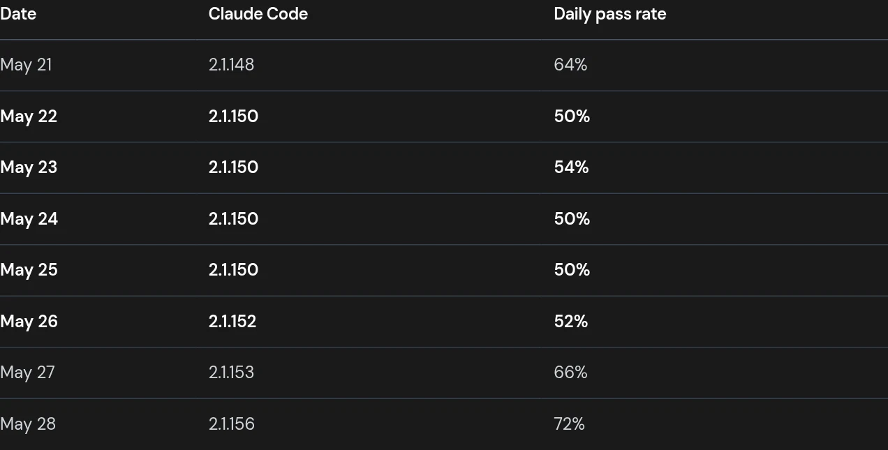
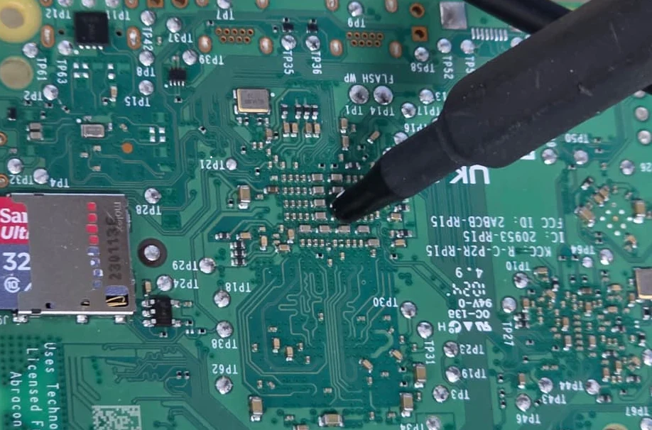

# Modelos locais e especializados para desenvolvimento e QA

Relatório cumulativo de pesquisa. Atualizado em 16 de outubro de 2026.

Modelos menores especializados podem superar modelos generalistas maiores em fluxos delimitados. A implantação local pode reduzir dependências externas e tornar a inferência acessível em estações de trabalho. A decisão depende da qualidade no fluxo real, da memória necessária, da concorrência e do custo completo da operação.

Este relatório reúne casos empresariais, benchmarks de modelos abertos, infraestrutura Apple Silicon e o estudo Snorkel e UC Berkeley sobre especialização de um modelo de 4B parâmetros. Resultados publicados pelos autores são identificados como tais; nenhuma execução de modelo ou reprodução experimental foi realizada nesta pesquisa.

## Como interpretar as evidências

| Categoria | O que estabelece |
|---|---|
| Estudo controlado | Efeito observado nas condições e participantes do experimento |
| Caso empresarial identificado | Uso real, com métricas que podem ser autorrelatadas |
| Benchmark dos autores | Capacidade no conjunto e protocolo publicados |
| Demonstração de hardware | Viabilidade e desempenho naquela configuração |
| Tutorial ou produto disponível | Possibilidade de implantação, sem provar adoção ou retorno |
| Inferência de engenharia | Hipótese para orientar um piloto, ainda dependente de medição |

Execução na máquina do profissional, servidor on-premises e VPC são modalidades diferentes. Uma ferramenta interna de big tech não comprova, por si só, inferência em notebooks ou em um cluster local de desktops.

## Casos empresariais de desenvolvimento e QA

| Organização | Uso e resultados publicados | Alcance da evidência |
|---|---|---|
| Google | Complementação interna de código: mais de 10 mil desenvolvedores, três meses, redução de 6% no tempo entre builds e testes | Produção interna; não demonstra inferência no notebook. [Fonte](https://research.google/blog/ml-enhanced-code-completion-improves-developer-productivity/?hl=en_GB&version=v1) |
| Google | Experimento com 96 engenheiros: redução estimada de 21% no tempo de uma tarefa empresarial, com intervalo de confiança amplo | Estudo controlado; generalização limitada a outros fluxos. [Artigo](https://arxiv.org/abs/2410.12944) |
| IBM | watsonx Code Assistant: economia média autorrelatada de 56% em explicação, 59% em documentação, 38% em geração de código e 38% em geração de testes | Desafio interno; topologia de inferência não detalhada. [Caso](https://www.ibm.com/case-studies/ibm-software-team) |
| Meta | TestGen-LLM: 75% dos testes gerados compilavam, 57% passavam confiavelmente e 25% aumentavam cobertura; 73% das recomendações aceitas nos test-a-thons | Dois LLMs internos; validação automática antes da recomendação. [Artigo](https://arxiv.org/abs/2402.09171) |
| Apple | Minions distribui inferência pelas GPUs de Macs ociosos | Plataforma de inferência distribuída; não mede produtividade de programação. [Publicação](https://machinelearning.apple.com/research/distributed-gpu-cloud) |

Os números da IBM envolvem 107 equipes para explicação, 153 para documentação, 112 para geração de código e 34 para testes. O caso não sustenta atribuir esses ganhos a Granite executado localmente. A IBM publica separadamente um [tutorial de Granite 4 com Ollama, Continue e VS Code](https://developer.ibm.com/tutorials/awb-local-ai-copilot-ibm-granite-code-ollama-continue/), que documenta a arquitetura local.

No estudo da Meta, “25% dos testes aumentaram cobertura” não significa aumento de 25% na cobertura total. O fluxo combina geração com compilação, execução e filtragem de candidatos. É uma referência útil para avaliar testes produzidos por modelos locais.

O [Tabnine](https://www.tabnine.com/platform/) oferece implantação on-premises e air-gapped. A disponibilidade comercial dessa modalidade não identifica qual arquitetura cada cliente utiliza.

A [MetaDesign Solutions](https://metadesignsolutions.com/case-study/air-gapped-ai-ide-financial-institution) relata DeepSeek Coder quantizado em GPUs privadas com Kubernetes e extensão VS Code para um banco anônimo, com mais de 800 desenvolvedores em 60 dias. A página associa 40% a métricas diferentes; o percentual não é uma base suficientemente clara para estimar retorno de investimento.

## Mac minis e servidores compartilhados

### Yembo

O CTO Zach Rattner descreve oito Mac minis M4/M4 Pro, inicialmente com duas máquinas dedicadas à IA. whisper.cpp e Silero VAD substituíram transcrição em nuvem, com economia declarada de US$ 40 mil por ano. O cluster também executa GitHub Actions, CircleCI e regressões Playwright; build e lint passaram, segundo o relato, de quatro minutos para 40 segundos. [Relato original](https://zachrattner.com/projects/ai-mac-cluster)

A economia financeira publicada pertence à transcrição. A melhoria de build pertence à infraestrutura de CI. Nenhuma dessas métricas deve ser apresentada como ganho comprovado de um LLM escrevendo código.

### EXO

Demonstração em oito Mac minis M4 Pro de 64 GB, com 512 GB agregados e modelos em 4 bits:

| Modelo | Primeiro token | Geração |
|---|---:|---:|
| DeepSeek V3 671B | 2,91 s | 5,37 tokens/s |
| Llama 3.1 405B | 29,71 s | 0,88 tokens/s |
| Llama 3.3 70B | 3,14 s | 3,89 tokens/s |

Fonte: [EXO](https://blog.exolabs.net/day-2/). Os valores demonstram execução nessa configuração; não dimensionam dezenas de sessões simultâneas.

Para uma API interna, há duas opções a comparar: dividir os pesos de um modelo entre máquinas ou distribuir requisições entre réplicas completas. A primeira amplia a capacidade de memória; a segunda pode ampliar a capacidade de atender usuários. A escolha exige medir prefill, geração, filas e latência sob concorrência.

## Modelos abertos e benchmarks de código

Resultados declarados pelos desenvolvedores, consultados na primeira rodada desta pesquisa:

| Modelo | Arquitetura | Resultados publicados |
|---|---|---|
| Qwen3.6-35B-A3B | MoE de 35B totais e aproximadamente 3B ativos | SWE-bench Verified 73,4; Pro 49,5; Terminal-Bench 2.0 51,5. [Fonte](https://huggingface.co/Qwen/Qwen3.6-35B-A3B) |
| Qwen3.8-27B | 27B, blocos densos | SWE-bench Pro 61,7; Terminal-Bench 2.1 73,0; NL2Repo 42,3. [Fonte](https://huggingface.co/Qwen/Qwen3.8-27B) |
| Qwen3.8-Flash-Next | 125B principais, 6B ativos, mais 51B de embeddings n-gram | SWE-bench Pro 62,5; Multilingual 81,0; NL2Repo 48,1. [Fonte](https://huggingface.co/Qwen/Qwen3.8-Flash-Next) |
| DeepSeek-V4.1-Flash | 552B no backbone e 196B de memória Engram | DeepSWE v1.1 74,2 com mini-SWE; Terminal-Bench 2.1 90,6 com DeepSeek Harness Minimal. [Fonte](https://huggingface.co/deepseek-ai/DeepSeek-V4.1-Flash) |

A tabela não é um ranking uniforme. Há versões diferentes de benchmarks, agentes, contextos e orçamentos. A Qwen informa correções de tarefas no SWE-bench Pro. O próprio DeepSeek reporta DeepSWE 69,8 com Claude Code e 74,2 com mini-SWE, ilustrando a influência do agente que envolve o modelo.

### Memória e SSD offloading

Parâmetros ativos indicam uma característica de computação, não o total de pesos a armazenar. Aproximações de pesos puros em 4 bits: 35B correspondem a 17,5 GB e 27B a 13,5 GB. Cache, metadados, buffers e sistema operacional exigem memória adicional.

O [relatório DeepSeek-V4.1](https://arxiv.org/html/2609.19969v1) descreve redução do cache KV persistente para cerca de 1/8 do usado por V4-Flash. Isso não significa reduzir a memória do modelo inteiro na mesma proporção. O [artigo Qwen3.8-Next](https://arxiv.org/abs/2608.30320) descreve embeddings n-gram mantidos fora do acelerador. Acesso esparso a tabelas, transferência de especialistas e offload de cache são mecanismos diferentes.

## Estudo Snorkel e UC Berkeley sobre um especialista de 4B

### Resultado principal

O rLLM-FinQA-4B foi ajustado a partir de Qwen3-4B-Instruct-2507 com GRPO. A comparação publicada usa Qwen3-235B-A22B, um MoE; a razão aproximada de 59 vezes refere-se a parâmetros totais, não a uma redução medida de 59 vezes no custo ou na latência.

| Modelo | FinQA | FinQA Reasoning |
|---|---:|---:|
| Qwen3-4B-Instruct-2507 antes do ajuste | 27,90% | 13,90% |
| Qwen3-235B-A22B | 51,37% | 18,90% |
| rLLM-FinQA-4B após o ajuste | 59,70% | 26,60% |

Fonte: [model card oficial](https://huggingface.co/rLLM/rLLM-FinQA-4B). Ganhos calculados: +31,8 pontos percentuais no FinQA contra o 4B original; +8,33 contra o 235B. No Reasoning, +12,7 pontos contra o 4B original, aproximadamente 91,4% de melhora relativa.

São benchmarks de análise financeira com ferramentas. O resultado demonstra especialização eficaz nessa distribuição de tarefas; não mede desenvolvimento geral de software nem adoção por uma equipe empresarial.

### O exemplo da receita de anúncios do YouTube

Na transcrição fornecida da [palestra de Kobie Crawford](https://www.youtube.com/watch?v=TNwJ1LMiENk), o 235B tenta consultar uma tabela inexistente, repete a tentativa e responde sem obter os dados. O 4B ajustado descobre as tabelas, inspeciona o schema, consulta, encontra um erro de coluna e corrige a consulta antes de responder.

| Trecho do vídeo | Assunto |
|---|---|
| [7min08s](https://www.youtube.com/watch?v=TNwJ1LMiENk&t=428s) | Falha do modelo de 235B |
| [10min47s](https://www.youtube.com/watch?v=TNwJ1LMiENk&t=647s) | GRPO e custo da execução |
| [14min32s](https://www.youtube.com/watch?v=TNwJ1LMiENk&t=872s) | Descoberta, schema e autocorreção no 4B |
| [16min32s](https://www.youtube.com/watch?v=TNwJ1LMiENk&t=992s) | Ablações e transferência para múltiplas tabelas |
| [18min30s](https://www.youtube.com/watch?v=TNwJ1LMiENk&t=1110s) | Rubricas para diagnosticar comportamentos |

O exemplo ilustra o mecanismo; a tabela agregada é a evidência de desempenho. Os links do vídeo e da página AIE não puderam ser lidos pelo navegador desta pesquisa; os detalhes narrativos e timestamps acima vêm da transcrição enviada pelo usuário, corroborada quanto ao resultado geral pelas publicações dos autores.

### Dados e versões do ambiente

O ambiente OpenEnv publicado pela Snorkel contém 290 perguntas de avaliação sobre 22 empresas. A palestra também descreve 79 exemplos de raciocínio mais complexo. Esses conjuntos de avaliação não devem ser confundidos com o corpus de treinamento. [Descrição do ambiente](https://snorkel.ai/blog/building-finqa-an-open-rl-environment-for-financial-reasoning-agents/)

Há diferenças de interface: a model card lista `get_table_names`, `get_table_info`, `sql_query` e `calculator`. A versão OpenEnv descreve `get_descriptions`, `get_table_info`, `sql_query` e `submit_answer`. A fala transcrita usa `get_table_name`. Para reprodução, deve-se fixar a versão do ambiente e seu contrato de ferramentas.

A model card descreve recompensa com LLM avaliador; o artigo OpenEnv descreve comparação numérica normalizada e recompensa binária. São descrições de versões que não devem ser fundidas em uma única receita sem verificar o código correspondente.

### Treinamento simples e transferência

A Snorkel publica as seguintes ablações internas de Pass@1: somente tabela única, 66,3%; mistura de uma e várias tabelas, 61,6%; currículo de uma para várias tabelas, 64,8%. Os 66,3% pertencem à ablação interna, enquanto 59,7% é o resultado publicado do benchmark principal. [Publicação de 18 de fevereiro de 2026](https://snorkel.ai/blog/how-tool-discipline-let-a-4b-model-outsmart-a-235b-giant-on-financial-tasks/)

O treinamento com tarefas simples apresentou transferência para perguntas de múltiplas tabelas. Isso sustenta que descobrir recursos e reagir a erros eram comportamentos relevantes naquele ambiente. Não estabelece que tarefas complexas devam sempre ser excluídas do treinamento.

### Custo do treinamento e economia de inferência

A Snorkel informa oito GPUs H100 e custo inferior a US$ 500 por execução. A palestra menciona aproximadamente 21 horas. A publicação também projeta redução de 90% no custo de inferência para um cenário de 50 mil consultas mensais. A projeção não é uma economia auditada em um cliente identificado. [Fonte Snorkel](https://snorkel.ai/blog/how-tool-discipline-let-a-4b-model-outsmart-a-235b-giant-on-financial-tasks/)

O valor por execução não deve ser interpretado como custo completo de criar o especialista. Para orçamento empresarial, devem ser contabilizados separadamente dados, especialistas, engenharia do ambiente, avaliações, experimentos malsucedidos e manutenção. O custo publicado tampouco significa que o treinamento ocorreu em um notebook.

### Execução na máquina do desenvolvedor

Os pesos estão disponíveis em BF16 sob Apache 2.0; o repositório contém aproximadamente 8,84 GB, incluindo dois arquivos de pesos de cerca de 4,41 GB cada. Isso torna a implantação local muito mais acessível do que armazenar centenas de bilhões de parâmetros. [Arquivos publicados](https://huggingface.co/rLLM/rLLM-FinQA-4B/tree/main)

Como estimativa de engenharia, uma GPU de 16 GB é uma candidata plausível para testar esse modelo em BF16 com contexto e concorrência limitados. O consumo real inclui cache e buffers; o tamanho dos arquivos não é uma garantia de caber em uma GPU de 8 GB. Não há nesta pesquisa medição de tokens/s em GPU de consumidor ou Mac, nem confirmação de preservação da qualidade após quantização.

Uma aplicação inteiramente local precisa manter também ferramentas, dados e serviços necessários dentro da infraestrutura definida. Hospedar os pesos localmente não torna automaticamente local todo o fluxo.

## Aplicação da especialização a desenvolvedores e QAs

A hipótese apoiada pelo estudo é que um modelo pequeno pode aprender procedimentos recorrentes com ferramentas e superar um generalista maior nesse fluxo. A transferência para desenvolvimento deve ser medida com tarefas de software, pois o experimento FinQA não a testou diretamente.

| Comportamento no estudo | Hipótese de aplicação em software | Critério de avaliação proposto |
|---|---|---|
| Descobrir tabelas antes de consultar | Procurar arquivos e símbolos antes de editar | Referências e arquivos realmente existem |
| Inspecionar schema | Ler assinatura de API, tipos e configuração | Chamada compatível com o projeto |
| Corrigir erro de coluna | Reagir a falha de compilação ou teste | Correção elimina a falha sem regressão |
| Responder com dados obtidos | Fundamentar diagnóstico em logs e execução | Evidência corresponde à conclusão |
| Usar ferramentas seletivamente | Executar testes relevantes | Defeito reproduzido e teste detecta a falha |

As rubricas sugeridas na palestra ajudam a separar erro de descoberta, interpretação, chamada de ferramenta, recuperação e resposta final. Essa decomposição orienta quais exemplos produzir antes de investir em treinamento. A recompensa usada no RL pode continuar escalar; uma rubrica de diagnóstico não precisa ser a própria função de recompensa.

Para um piloto, comparar modelo original, modelo original com instruções e agente melhorados, e modelo especializado. Manter tarefas de teste separadas do treinamento e incluir repositórios ou períodos novos. Medir sucesso, regressões, revisão humana, latência e custo por tarefa aceita. Assim é possível saber quanto do ganho vem do treinamento e quanto vem do ambiente.

## Outras empresas com especialistas pequenos e execução local

Pesquisa complementar de 16 de outubro de 2026. Os casos abaixo distinguem resultados de especialização, produtos utilizáveis e economia publicada. Nenhum percentual é uma promessa geral para outro ambiente.

### JetBrains e Mellum para complementação de código

A JetBrains descreve um pipeline industrial de modelos de 4B com treinamento contextual, fill-in-the-middle e alinhamento por DPO. O artigo de outubro de 2025 relata implantação para centenas de milhares de usuários e avaliações com telemetria de produção. [Artigo Mellum](https://arxiv.org/abs/2510.05788)

Na publicação de abril de 2025, a taxa de aceitação de sugestões era 35% em Java e Python e 44% em Go. A participação do Mellum no código digitado no editor era 23%, 23% e 30%, respectivamente. Essas métricas pertencem ao serviço de complementação em nuvem descrito no artigo, não a uma avaliação da versão local. Aceitação de sugestões também não equivale a redução proporcional no prazo de entrega. [Treinamento e métricas](https://blog.jetbrains.com/ai/2025/04/mellum-how-we-trained-a-model-to-excel-in-code-completion/)

Em julho de 2025, a empresa anunciou execução local de Mellum-all por Ollama ou LM Studio no AI Assistant e uma extensão própria para VS Code. A extensão utiliza Mellum-4b-sft-all. É evidência direta de produto para programação na máquina do desenvolvedor. [Anúncio local](https://blog.jetbrains.com/ai/2025/07/whats-new-with-mellum-expanded-language-support-and-new-ways-to-use-it-locally/) e [extensão demonstrável](https://marketplace.visualstudio.com/items?itemName=JetBrains.local-mellum).

Classificação: produto em uso, modelo especializado e caminho local documentado. A especialidade principal desta versão é complementação, não resolução autônoma de qualquer tarefa de engenharia.

### Google e FunctionGemma para ferramentas no dispositivo

FunctionGemma é uma variante de 270M especializada em chamadas de função. A Google reporta aumento de 58% para 85% na avaliação Mobile Actions após fine-tuning, em conjunto separado de avaliação. O anúncio de dezembro de 2025 inclui Tiny Garden no AI Edge Gallery e Physics Playground no navegador como demonstrações locais. [Anúncio e demonstrações](https://blog.google/innovation-and-ai/technology/developers-tools/functiongemma/)

Há um [notebook oficial de ajuste para Mobile Actions](https://github.com/google-gemini/gemma-cookbook/blob/main/FunctionGemma/%5BFunctionGemma%5DFinetune_FunctionGemma_270M_for_Mobile_Actions_with_Hugging_Face.ipynb). O resultado conecta treinamento específico e execução no dispositivo, mas mede ações móveis, não programação. Para QA, um controlador de ferramentas restritas é uma aplicação a investigar; o estudo não demonstra um agente geral de testes.

Classificação: benchmark dos autores e demonstrações reproduzíveis; sem cliente empresarial identificado ou economia monetária medida nesse anúncio.

### Rocketgraph com distil labs e IBM Power

A Rocketgraph publicou em outubro de 2025 uma solução baseada em Granite 3.3 8B ajustado para seu dialeto OpenCypher. Descreve mais de 15 mil exemplos validados e execução na infraestrutura IBM Power. O relato anuncia tradução de consultas abaixo de 200 ms, comparada a 2–5 segundos em LLMs remotos incluindo rede. Também afirma atingir 85% do desempenho de Claude 4. [Relato da Rocketgraph](https://rocketgraph.com/2025/10/distil-labs-enables-rocketgraphs-private-ai-on-ibm-power/)

O caso não sustenta dizer que o 8B superou Claude 4: 85% é uma comparação relativa cujo protocolo não é detalhado suficientemente na página. Os anúncios de 10 vezes mais velocidade e 100 vezes menos energia devem permanecer como alegações do fornecedor, sem tratá-los como comparação controlada de hardware.

A publicação da distil labs explica a especialização: modelos generalistas geravam sintaxe Cypher incompatível e omitiam funções específicas do produto. Documentação e exemplos foram convertidos em dados sintéticos validados no próprio sistema. [Processo de adaptação](https://www.distillabs.ai/blog/distil-labs-enables-rocketgraphs-private-ai-on-ibm-power-with-small-language-models/)

Classificação: solução comercial relatada pela empresa que a incorpora, com infraestrutura identificada. É um precedente próximo de especializar um modelo para APIs, bibliotecas ou linguagens internas.

### Knowunity e economia de especialização em produção

A Knowunity utiliza modelos personalizados da distil labs para tarefas selecionadas, incluindo classificação de perguntas por matéria escolar. O fornecedor publica comparação em conjunto separado de teste e custos obtidos de uso em produção durante vários dias:

| Métrica | Gemini 2.5 Flash Lite | Modelo especializado |
|---|---:|---:|
| Acurácia | 81% | 93% |
| Latência p50 | 0,49 s | 0,27 s |
| Latência p95 | 0,81 s | 0,59 s |
| Custo por milhão de requisições | US$ 109 | US$ 35 |

O relato atribui aproximadamente 68% de economia às tarefas selecionadas. Os testes de latência usaram rajadas de até 10 requisições/s, enquanto o tráfego produtivo informado supera 130/s. Portanto, a tabela não mede diretamente a latência nessa carga maior. [Caso Knowunity](https://www.distillabs.ai/blog/how-knowunity-used-distil-labs-cut-llm-bill-68-percent/)

Classificação: caso comercial identificado e métricas do fornecedor com depoimento do CTO. Comprova economia relatada de especialização; a implantação descrita usa a plataforma de inferência do fornecedor e não comprova execução on-premises. O número exato de parâmetros do modelo implantado não é informado.

### Octodet e análise especializada de logs

A distil labs relata ajuste de Llama 8B para a Octodet, usando conhecimento de segurança e exemplos sintéticos. A avaliação atribui notas por LLM avaliador a quatro partes da resposta. O agregado foi 57% contra 47% do melhor LLM comparado; na seção de classificação, 88% contra 63% de Qwen3-235B-A22B. [Método e resultados](https://www.distillabs.ai/blog/teaching-small-language-models-new-skills-training-a-local-cybersecurity-agent/)

Esses números são pontuações do protocolo descrito, não sensibilidade, especificidade ou taxa de detecção comprovada em incidentes reais. A [página de implantação](https://www.distillabs.ai/use-cases/regulated-and-on-prem/) informa execução on-premises.

Classificação: cliente identificado em relato do fornecedor, com comparação de especialização e implantação privada. O uso é segurança; a aplicação à triagem de logs de testes e CI é uma hipótese de transferência.

### Mistral e All Hands AI com Devstral

O Devstral original, publicado em maio de 2025, foi treinado para resolver issues reais e alcançou 46,8% no SWE-bench Verified. A Mistral reporta superar DeepSeek-V3-0324 de 671B sob o mesmo agente OpenHands. O anúncio inclui documentação e vídeo tutorial de uso local. [Anúncio Devstral](https://mistral.ai/news/devstral/)

O [artigo técnico](https://arxiv.org/abs/2509.25193) descreve Devstral-Small como um modelo de 24B ajustado para agentes de código. É uma evidência mais direta de especialização para engenharia de software do que FinQA, embora o resultado ainda seja de benchmark.

Para a geração posterior Devstral Small 2, a documentação do Vibe oferece implantação por API local e indica GPU de 24 GB para 4 bits e contexto de 32K. Essa configuração não é a condição do benchmark do Devstral original e não herda automaticamente sua pontuação. [Guia de uso offline](https://docs.mistral.ai/vibe/code/cli/offline-models)

Classificação: modelo aberto, benchmark e integração local documentada; sem ganho empresarial de produtividade atribuído aqui.

### Salesforce com APIGen e xLAM

A Salesforce publicou xLAM em tamanhos de 1B e 7B, entre outros, especializados em chamadas de função. O pipeline APIGen combina 3.673 APIs executáveis em 21 categorias e valida formato, execução e semântica dos exemplos. No BFCL V1 da época, a empresa reportou que xLAM-7B superava modelos GPT-4 e Claude 3 Opus. [Publicação de setembro de 2024](https://www.salesforce.com/blog/xlam-large-action-models/) e [artigo APIGen](https://arxiv.org/abs/2406.18518).

Classificação: pesquisa com modelos e dados públicos. A comparação histórica apoia especialização para ferramentas; não é uma classificação atual de modelos nem prova que clientes Salesforce executem xLAM nos próprios computadores.

### Microsoft Research com rStar-Coder

O artigo rStar-Coder, de maio de 2025, descreve 418 mil problemas de programação competitiva e 580 mil soluções com raciocínio e testes verificáveis. Reporta Qwen2.5-7B passando de 17,4% para 57,3% no LiveCodeBench; o 14B passa de 23,3% para 62,5%. [Artigo](https://arxiv.org/abs/2505.21297)

Classificação: pesquisa de especialização com ganho medido em programação. O benchmark não equivale à manutenção de repositórios, e o estudo não apresenta uma equipe de desenvolvedores usando o modelo localmente em produção. Também não demonstra custo de ajuste comparável aos US$ 500 do FinQA.

### NVIDIA Research e arquiteturas com vários tamanhos de modelo

O artigo de posição Small Language Models are the Future of Agentic AI recomenda especializar modelos pequenos para etapas repetitivas e reservar modelos maiores para necessidades mais amplas. Propõe uma arquitetura heterogênea e uma abordagem de conversão de agentes baseados em LLM para SLM. [Página do estudo](https://research.nvidia.com/labs/lpr/slm-agents/)

Classificação: argumento técnico e proposta arquitetural, não caso de cliente ou comprovação universal de economia. É útil como fundamento para separar subtarefas de um agente de desenvolvimento.

### O que estes casos acrescentam à decisão

| Pergunta | Evidência mais diretamente relacionada |
|---|---|
| Há produto de código com modelo pequeno disponível localmente? | JetBrains Mellum |
| Ajuste de um modelo minúsculo melhora chamadas de ferramentas? | Google FunctionGemma |
| Uma empresa incorpora especialista em infraestrutura própria? | Rocketgraph em IBM Power |
| Existe economia publicada em produção? | Knowunity, em tarefas selecionadas e inferência hospedada |
| Um modelo menor pode superar um maior em engenharia de software? | Devstral, sob o protocolo SWE-bench/OpenHands publicado |
| Dados verificáveis melhoram pequenos modelos de código? | Microsoft rStar-Coder |
| Há precedente para logs especializados em ambiente privado? | Octodet, com avaliação por LLM juiz |

Os métodos diferem: GRPO no FinQA, ajuste e DPO no Mellum, dados supervisionados e distilação em outros casos. O conjunto apoia especialização, avaliação por tarefa e escolha de tamanho adequada; não permite atribuir todos os ganhos ao mesmo método de treinamento.

## Modelos pequenos especializados em código: benchmarks e alcance da evidência

Pesquisa ampliada em 16 de outubro de 2026. “Pequeno” nesta seção identifica principalmente modelos densos de 4B–14B; 24B–32B entram como comparação. Modelo barato por API não implica poucos parâmetros, e parâmetros ativos de um MoE não equivalem à memória necessária para armazenar todos os pesos.

### Avaliação externa dos modelos: Aider

O benchmark histórico de edição do Aider exige modificar arquivos Python em 133 exercícios do Exercism e aplicar corretamente as alterações. É uma avaliação externa aos fabricantes dos modelos, executada no agente Aider; não representa todo o trabalho de engenharia. Foi substituído pelo Polyglot, mais difícil.

| Modelo | Resultado histórico de edição | Formato registrado |
|---|---:|---|
| Qwen2.5-Coder-7B-Instruct | 57,9% | whole |
| Qwen2.5-Coder-14B-Instruct | 69,2% | whole |
| Qwen2.5-Coder-32B-Instruct | 71,4% | diff |
| Yi-Coder-9B-Chat | 54,1% | whole |

Esses resultados mostram capacidade útil de pequenos especialistas em edição, mas não devem ser lidos como percentuais de produtividade ou de resolução de issues empresariais. Os formatos e configurações diferem. [Tabela original e protocolo](https://aider.chat/docs/leaderboards/edit.html)

### Especialização para resolver issues: SWE-Lego 8B

O SWE-Lego ajusta Qwen3-8B por treinamento supervisionado, com trajetórias de agentes e tratamento de erros intermediários. Reporta **42,2% em pass@1 no SWE-bench Verified**; com 16 trajetórias e seleção por verificador, chega a **49,6%**. O 32B alcança 52,6% e 58,8%, respectivamente. Há código, dados e scripts publicados.

É evidência diretamente relacionada a manutenção de repositórios, mais próxima do trabalho de desenvolvimento que programação competitiva. Porém, os números são dos autores, não uma reprodução independente. TTS@16 consome múltiplas tentativas e um verificador: não equivale ao custo de uma chamada de 8B. A publicação não comprova a mesma pontuação após quantização ou em um notebook. [Projeto, método e resultados](https://swe-lego.github.io/)

### Evidência empresarial e outros especialistas já documentados

| Caso | O que sustenta | O que permanece sem comprovação |
|---|---|---|
| JetBrains Mellum 4B | Especialista de autocomplete em produto comercial; opção local documentada | Métricas de produção cloud não medem automaticamente a versão local |
| Microsoft rStar-Coder 7B | Grande ganho no LiveCodeBench após especialização | Produtividade empresarial e custo total de treinamento |
| Devstral 24B | Especialização em agentes de engenharia e implantação local documentada | Mesma qualidade e latência na quantização escolhida pelo usuário |
| Salesforce xLAM 1B/7B | Especialistas em chamadas de ferramentas | Desempenho geral como agente de código ou adoção em desktops de clientes |

As fontes e números desses casos estão nas respectivas seções anteriores. Entre os casos encontrados, Mellum é o exemplo mais direto de produto de código pequeno; SWE-Lego é pesquisa de resolução de issues. Não reuni ambos sob o rótulo de implantação empresarial comprovada.

## Arquiteturas híbridas exclusivamente local + nuvem

Escopo corrigido por solicitação expressa do usuário: o híbrido deve executar uma LLM na máquina do desenvolvedor ou em servidor próprio e outra na nuvem. Combinações exclusivamente entre APIs remotas foram retiradas desta seção e da síntese. A execução de ferramentas locais por um modelo remoto, sem uma LLM local, não atende ao critério.

### Nav: delegação de código para Qwen em Mac, com Claude na nuvem

O repositório público `navikt/mlx-workspace` documenta um estudo de agosto de 2026 com Claude Sonnet 4.6 como orquestrador remoto e Qwen3.6-35B-A3B-OptiQ local, quantização mista 4/8 bits, em M4 Max com 48 GB. O braço híbrido usa opencode; a comparação com sessões locais no Copilot CLI é outro experimento.

Em tarefas Ktor, a mediana caiu de US$ 0,106 para US$ 0,085 em renomeação e de US$ 0,339 para US$ 0,134 ao propagar um campo: aproximadamente 19% e 61% de economia de nuvem, com os mesmos resultados nas verificações. Entretanto, a tarefa análoga em Spring custou 1,79 vez mais no híbrido. Há amostras pequenas por comparação; a suíte já apresentava falhas antes das alterações e o critério considera novas falhas.

É evidência organizacional com código e resultados públicos, não auditoria independente nem economia de toda a organização. O custo não inclui TCO do Mac. O modelo tem 35B parâmetros totais e 3B ativos: não ocupa a memória de um modelo denso de 3B. [Relatório técnico](https://github.com/navikt/mlx-workspace/blob/main/reports/local-inference-findings.md)

### MCCom: autocomplete com modelo local de 121M e modelo na nuvem

O artigo Balancing Latency and Accuracy of Code Completion via Local-Cloud Model Cascading descreve um modelo local de 121 milhões de parâmetros e acionamento do modelo remoto guiado por ações do usuário. Inclui decodificação especulativa e recuperação iterativa de contexto.

Em RepoEval e StmtEval, os autores reportam até 47,9% menos latência e 46,3% menos uso do LLM, com melhoria reportada de 8,9% em exact match. Redução de uso não equivale automaticamente à mesma redução monetária. É pesquisa aceita no FSE 2026, segundo o registro, não caso empresarial em produção. O resultado é autocomplete de linhas, não resolução completa de issues. [Artigo](https://arxiv.org/abs/2603.05974)

### Hybrid Coding Arena: benchmark reproduzível em laptop

A RunAnywhere publica um ambiente comparando rotas locais, remotas e híbridas em um M4 Max de 64 GB. O cenário Cline + Qwen3.6 + cascata registra 24/24 aprovações nas tarefas D1/D5, fração de nuvem de 8% e US$ 0,022 por tarefa. Não se deve converter essa fração em 92% de economia total.

Os arquivos de configuração, resultados e metodologia estão disponíveis. É benchmark dos próprios proponentes, com poucos tipos de tarefas e repetições; 24 execuções não significam 24 tarefas distintas. O rótulo histórico “refactors” inclui adições de funcionalidade e scripts. Não é implantação de cliente nem comprovação de desempenho em repositórios grandes. [Repositório e limitações](https://github.com/RunanywhereAI/hybrid-arena)

### MinionS: execução local com coordenação na nuvem

O trabalho de Stanford e colaboradores faz o modelo remoto decompor a tarefa e o modelo local processar partes dos documentos, retornando resultados selecionados. Reporta **5,7 vezes menos custo remoto**, preservando **97,9% do desempenho** da execução exclusivamente remota. Isso corresponde aproximadamente a 82,5% de redução da despesa remota, com pequena perda relativa de desempenho.

Os testes envolvem documentos financeiros, médicos e científicos; não são benchmark de programação. O número é custo de inferência remota, não TCO com compra de hardware, energia e operação local. É demonstração de pesquisa, sem caso empresarial de código comprovado nessa publicação. Serve como fundamento para testar leitura local de arquivos e envio de contexto reduzido, aplicação que aqui é inferência nossa. [Artigo Minions](https://arxiv.org/abs/2502.15964) e [demonstração técnica](https://hazyresearch.stanford.edu/blog/2025-02-24-minions).

## Casos de uso para demonstrar economia com local + nuvem

Ampliação de 16 de outubro de 2026, focada em resultados econômicos. Economia de API, redução de tokens e TCO são métricas diferentes. Os números abaixo pertencem às condições e preços dos estudos; não são projeções automáticas para modelos atuais ou para qualquer equipe.

### HERA: geração de código e agentes com etapas executadas localmente

Pesquisa da University of Virginia com autores da Microsoft, usando modelos locais via llama.cpp em RTX 4090 e modelos remotos por API. O par principal é Mistral 7B + GPT-4; também há avaliação com Llama 8B + Claude 3.5.

| Uso avaliado | Somente nuvem, US$/solicitação | Híbrido, US$/solicitação | Redução calculada a partir da tabela |
|---|---:|---:|---:|
| Geração de funções, HumanEval | 0,056 | 0,044 | 21,4% |
| Perguntas com múltiplas etapas, HotpotQA | 0,054 | 0,043 | 20,4% |
| Agente de compras, Webshop | 0,084 | 0,058 | 31,0% |

A tabela monetiza uso remoto, tratando o modelo local como custo zero; não inclui aquisição, energia e manutenção. Há perda de qualidade em relação à execução inteiramente remota. O texto também alterna referências a GPT-4/GPT-4o e arredonda a faixa econômica, portanto os valores servem como evidência experimental histórica, não orçamento atual. Não é implantação produtiva da Microsoft nem validação independente. [HERA, configuração e tabela 3](https://arxiv.org/html/2504.00434v1)

### Engenharia empresarial: economia total híbrida simulada, incluindo reparos

Inference Economics of Enterprise Coding Agents acompanha um desenvolvedor em dois períodos de 28 dias, comparando Claude por API e GLM on-premises. Depois simula roteamento híbrido sobre 613 commits, atribuindo custos de infraestrutura, operação e trabalho de reparo.

| Política no replay | TCO estimado | Economia contra API | Proporção simulada de commits de reparo |
|---|---:|---:|---:|
| Somente Claude/API | US$ 11.419 | Referência | 49,1% |
| Alta dificuldade na nuvem; demais locais | US$ 8.412 | 26,3% | 64,6% |
| Alta e média dificuldade na nuvem; demais locais | US$ 9.890 | 13,4% | 57,9% |

É simulação contrafactual com dados observados, não economia realizada por um gateway híbrido. Depende de alocação compartilhada de GPU, custos de trabalho de Taiwan e hipótese de escalabilidade linear. Os períodos não foram randomizados e mudam também ferramentas/configurações; não isolam causalmente o modelo. FCR é proporção de commits classificados como reparo, não percentual de usuários afetados por bugs. [Estudo, seção VI-C e tabela XIV](https://arxiv.org/html/2607.13080v1)

### DeloitteSage: caso empresarial de arquitetura econômica, sem percentual publicado

A Deloitte e a Intel documentam um acelerador com Llama 3.1 8B no AI PC e Claude via Bedrock para suporte de TI. Para sumarização, combina o mesmo 8B local com Llama 3.1 70B remoto. TechSage atende consultas e resolução de problemas; MeetingBuddy resume reuniões e agenda acompanhamentos. O roteamento considera complexidade, recursos disponíveis e sensibilidade dos dados.

O material demonstra uma aplicação empresarial concreta de local + nuvem projetada para reduzir gasto remoto, mas não apresenta tabela financeira antes/depois, quantidade de usuários, economia auditada ou benchmark independente. Deve ilustrar a arquitetura e os usos, não fundamentar uma porcentagem de economia. Não atribuímos a ele os 55% de outro estudo Deloitte em CPUs na AWS, que está fora deste escopo. [Caso DeloitteSage, especialmente páginas 3–4](https://www.deloitte.com/content/dam/assets-zone3/us/en/docs/services/consulting/2025/deloittesage-case-study.pdf)

### O que usar na argumentação econômica

| Uso | Evidência adequada | Afirmação sustentada |
|---|---|---|
| Alterações mecânicas em código | Experimentos Nav descritos acima | Delegação ao modelo local economizou despesa remota em tarefas específicas; o resultado pode inverter |
| Geração de funções | HERA | Há redução monetizada de API em benchmark, com custo local excluído e compromisso de qualidade |
| Leitura de documentos extensos | MinionS | Reduzir processamento remoto pode reduzir fortemente a despesa remota |
| Roteamento por dificuldade em repositório empresarial | Replay do estudo Inference Economics | TCO híbrido pode ser menor mesmo incluindo reparos, sob hipóteses explícitas |
| Suporte de TI e resumo de reuniões | DeloitteSage | Empresa grande desenvolveu arquitetura local + nuvem para eficiência; economia numérica não divulgada |

Para QA, os estudos consultados ainda não oferecem um caso forte de economia monetária em produção com geração de testes local + nuvem e qualidade equivalente. Benchmark de código e aceitação de patches não substituem taxa de defeitos detectados por testes.

### Resultados que não foram aceitos como prova de economia produtiva

- **Local-Splitter:** anuncia 45–79% menos tokens, mas a avaliação executa também o modelo que representa a nuvem localmente: Gemma 3 4B, com Llama 3.2 3B no outro papel. Usa dez amostras sintéticas por classe e avaliador de qualidade limitado. É simulação exploratória de técnicas, não demonstração de redução de uma fatura real de nuvem. [Limitações e configuração](https://arxiv.org/html/2604.12301v1)
- **Inference Sentinel:** reporta US$ 0,0844 contra US$ 0,2687 de baseline hipotético, ou 68,6%. São 200 prompts sintéticos, custo local zerado, latência local maior e sem demonstração de equivalência funcional. Há divergência entre legenda e tabela na fração local. Não usamos como caso empresarial nem como prova de economia mantendo qualidade. [Resultados e limitações](https://kraghavan.ca/llm/infrastructure/benchmarks/2026/03/21/inference-sentinel-benchmarks2.html)
- **Oflight:** apresenta cliente anônimo e números divergentes entre o título de 55% e a tabela de 65,6%; não publica logs ou avaliação de qualidade comparável. Não integra o conjunto principal de comprovação econômica. [Relato do fornecedor](https://www.oflight.co.jp/en/columns/hybrid-ai-cloud-local-llm-cost-reduction-2026)

### Como transformar esses casos em uma conta de retorno

Para uma implantação proposta, medir primeiro a diferença de gasto remoto por tarefa concluída, mantendo o mesmo critério de qualidade. Depois subtrair custo local incremental e revisão/retrabalho adicionais. O investimento inicial deve ser comparado com a economia líquida mensal, não com tokens eliminados.

`economia líquida mensal = API evitada − energia/operação local adicionais − revisão/retrabalho adicionais`

`payback em meses = investimento inicial / economia líquida mensal`

Para TCO contábil, incluir depreciação e custos recorrentes de hardware; para payback, usar o investimento inicial sem descontar novamente sua depreciação no fluxo de caixa. Equipamento já existente tem menor desembolso incremental, mas ainda pode ter custo de oportunidade e impacto no trabalho do desenvolvedor. Estas são orientações de cálculo, não economias observadas nas fontes.

## Recorte de engenharia: backend, frontend/UI e testes

Pesquisa ampliada em 16 de outubro de 2026. Mantido o requisito de uma LLM efetivamente local combinada com uma LLM remota. As evidências econômicas são mais sólidas para edição delimitada do que para criação integral de aplicações ou geração de testes.

### Nav: ampliação para frontend TypeScript e testes

Além dos backends já descritos, o estudo avaliou renomeação em `familie-tilbake-frontend`, com React 19 e Express 5. A mediana remota caiu de **US$ 0,227 para US$ 0,121**, redução calculada de **46,7%**; oito execuções por braço passaram pelas verificações, em suíte de 61 arquivos e 572 testes. Isso mede manutenção de código frontend, não qualidade visual de UI.

Nos testes unitários, incentivar delegação local resultou em uma falha entre duas amostras delegadas. Na investigação de três bugs frontend, o modelo local isolado não resolveu nenhum. São amostras pequenas e condições distintas; não demonstram economia em QA. O próprio relatório exclui generalizações para uso sustentado pela equipe. [Estudo Nav, seções 3.4, 7.3 e 7.4](https://github.com/navikt/mlx-workspace/blob/main/reports/local-inference-findings.md)

### Pulpcut: implementação de efeitos visuais com executor local

O desenvolvedor relata adicionar suporte a texturas e blending ao frontend Pulpcut, delegando `visualTexture.ts` e métodos de integração com FabricCanvasManager a modelos locais em RTX 5060 Ti de 16 GB. O modelo remoto coordena, revisa e integra; TypeScript, lint e testes validam. O executor preferido foi Qwen3-Coder-30B.

Em uma sessão, reportou cerca de US$ 10,60 de custo remoto e US$ 1,80 de custo equivalente evitado por aproximadamente 99 mil tokens locais. Este último valor é estimativa contrafactual, não resultado de executar a mesma tarefa integralmente na nuvem. Não inclui hardware, energia e revisão. As faixas de economia de 20–75% mencionadas pelo autor são expectativas, não benchmarks comprovados.

É relato primário individual, com instruções publicadas, sem auditoria ou repetição controlada. É útil por descrever trabalho concreto de UI, mas fraco para projetar economia empresarial. [Relato do experimento](https://www.reddit.com/r/vibecoding/comments/1t9eqad/i_tested_a_hybrid_localmodel_frontiermodel_coding/) e [configuração de orquestração](https://gist.github.com/AlexanderIstomin/ac7469ebaf7cba1e23bba328f424a48f).

### Testes E2E de UI e backend: visão local + geração remota

O artigo Agentic AI-Based Automated Test Case Generation and Execution descreve uma aplicação de gestão de turnos: requisitos DOCX são processados por LLM na API Groq; oito screenshots são analisados por LLaVA local via Ollama. O fluxo produz cenários Gherkin, revisão humana e scripts Python com Playwright/Pytest, incluindo interações de UI e verificações de API.

É um exemplo efetivo da arquitetura pedida aplicado a testes. Entretanto, a comparação publicada usa principalmente classificações qualitativas, não divulga custo antes/depois e não isola o ganho de executar visão localmente. A implantação em CI aparece como trabalho futuro. Portanto, classificado como demonstração acadêmica limitada de QA híbrido, sem economia comprovada. [Artigo, seções 5 e 6](https://www.irjet.net/archives/V13/i4/IRJET-V13I04372.pdf)

### Agentic QE: geração local com reparo, integração ainda a verificar

O projeto oferece Qwen3-Coder-30B via Ollama para gerar testes e repetir a tentativa após rejeição. A documentação apresenta configuração em conjunto com agentes remotos, mas contém uma divergência: README anuncia fallback, enquanto o guia informa explicitamente que a modalidade atual é local com reparo, sem escalada automática para modelos pagos. Não tratamos a cascata local→nuvem como funcionalidade confirmada ponta a ponta.

O teste objetivo descrito verifica presença de blocos de testes e asserções; isso não equivale a compilação, execução ou mutation score. Sem custo medido por teste útil publicado nessas páginas, é um candidato de implementação, não caso de economia. [README](https://github.com/proffesor-for-testing/agentic-qe) e [guia com status da funcionalidade](https://github.com/proffesor-for-testing/agentic-qe/blob/main/docs/guides/free-tier-local-models.md).

### Exemplos relacionados que não contam como híbridos local + nuvem

- **Cascaded Code Editing:** combina modelo grande e pequeno, mas a avaliação monetária usa preços de chamadas à DeepInfra. Não sustenta economia de uma implantação local + nuvem. [Método de custo](https://arxiv.org/html/2604.19201v1)
- **CodeLead/Silicon Exchange:** demonstra construção de aplicação React/TypeScript, regras de negócio e testes com modelo local, comparando execuções separadas locais e remotas. Não mostra o custo de uma execução conjunta híbrida. [Demonstração e limites](https://codelead.dev/case-study/)
- **QAMind:** gera testes com Qwen local, embora a aplicação use servidores para outros componentes. A página informa que inferência remota é possibilidade futura; aplicação hospedada com LLM local não equivale a duas LLMs local + nuvem. [Arquitetura](https://www.qamind.ai/local-ai)

### Matriz de evidência para engenharia de software

| Área | Caso dentro do escopo | Evidência de economia | Limite |
|---|---|---|---|
| Backend Kotlin/Ktor | Nav, propagação de campos e renomeação | Medida em tarefas, descrita acima | Não representa qualquer mudança de backend |
| Backend Spring | Nav | Contraprova: delegação aumentou custo | Impede prometer economia universal |
| Manutenção frontend React/TypeScript | Nav | 46,7% menos despesa remota no experimento | Renomeação; não design visual |
| Implementação de UI/canvas | Pulpcut | Tokens locais e custo evitado estimado | Sem comparação controlada ou TCO |
| Testes E2E e validação de APIs | Artigo com LLaVA + Groq | Não publicada | Demonstra arquitetura e geração de scripts |
| Geração de testes unitários | Agentic QE | Não publicada | Status de fallback contraditório; validação limitada |
| Autocomplete | MCCom, seção anterior | Menos uso remoto, não fatura comparada | Completar linhas não é entregar features |

Para sustentar uma proposta de economia, priorizar tarefas de manutenção com saída verificável e comparar o custo por alteração aprovada. Para UI, acrescentar critérios visuais, acessibilidade e interação; para QA, medir defeitos encontrados e testes não triviais. Estes critérios são uma proposta de avaliação nossa, não resultados já demonstrados pelos casos.

## Como reduzir viés na avaliação

Não há garantia de benchmark “não enviesado”. Nesta pesquisa, distinguimos avaliação externa ao fabricante, resultados reproduzíveis dos autores e relatos comerciais. Código aberto facilita auditoria, mas não transforma um resultado autorrelatado em validação independente.

O **LLMRouterBench** reúne mais de 400 mil instâncias, 21 datasets, 33 modelos e dez métodos de roteamento. Ao reavaliar métodos sob protocolo comum, encontra vários roteadores recentes, inclusive comerciais, que não superam consistentemente um baseline simples. Também observa retornos decrescentes ao aumentar o conjunto de modelos. É referência metodológica sobre avaliação de roteadores, não evidência de implantação local + nuvem; sua cobertura não substitui testes no repositório da empresa. [Artigo e recursos](https://arxiv.org/abs/2601.07206)

Para uma comparação de código e QA, propomos o seguinte protocolo, como recomendação metodológica nossa:

1. Usar issues e defeitos reais separados por data e repositório dos dados de ajuste; reservar tarefas inéditas para o teste final.
2. Comparar o mesmo agente, ferramentas, contexto, limite de tentativas e prazo em quatro condições: modelo forte, especialista sozinho, roteamento e divisão em especialistas.
3. Executar testes funcionais e regressivos. Para geração de testes, medir também defeitos detectados e mutation score, evitando usar apenas cobertura de linhas.
4. Medir custo por tarefa corretamente concluída, latência p50/p95, revisão humana, escalonamento, repetição e cache. Repetir execuções e reportar variação.
5. Avaliar o modelo quantizado no hardware real. Separar economia de API, custo total de inferência e retorno incluindo treinamento e manutenção.

Uma conta mínima para a cascata que sempre tenta o pequeno primeiro é:

`custo médio = custo pequeno + fração escalada × custo grande após escalada + validação + infraestrutura/operação alocada`

O custo do grande após escalada pode incluir todo o contexto anterior e uma nova tentativa. No roteamento direto, a chamada pequena não ocorre em toda tarefa. Para híbridos por subtarefa, somam-se os custos de todos os componentes. A métrica final deve dividir a despesa completa pelo número de tarefas aprovadas, incluindo o gasto com falhas.

### Síntese para a adoção

| Necessidade | Evidência que mais ajuda | Limitação principal |
|---|---|---|
| Autocomplete especializado pequeno | Mellum | Separar métricas cloud e local |
| Agente aberto pequeno para issues | SWE-Lego 8B | Resultado dos autores; custo e quantização a medir |
| Delegação de código local + nuvem em organização | Nav: Qwen no Mac + Claude remoto | Economia muda conforme tarefa; estudo limitado, não TCO |
| Autocomplete local + nuvem com especialista minúsculo | MCCom 121M | Menor uso remoto não é economia monetária medida |
| Reprodução de roteamento local + nuvem | Hybrid Coding Arena | Pequeno conjunto de tarefas; resultados dos proponentes |
| Colaboração efetiva local–nuvem | MinionS | Benchmark documental e custo remoto |
| Escolher roteador sem depender de marketing | LLMRouterBench e avaliação interna | Nenhum roteador domina todas as distribuições |

A evidência favorece especialistas pequenos para trabalhos delimitados e híbridos avaliados por custo por tarefa correta. Ainda não encontramos, nessas fontes, um caso que reúna simultaneamente pequena LLM local de código, empresa usuária identificada, economia total auditada e comparação independente controlada. Isso delimita o que foi demonstrado, sem invalidar os resultados parciais de produto e pesquisa.

## Benchmarks de Macs de 16 a 512 GB: RAM, SSD e geração

Pesquisa consultada em **16/10/2026**. Os números abaixo são medições publicadas por usuários e desenvolvedores de runtimes, não testes executados por nós. Não existe aqui um ensaio único que controle simultaneamente chip, quantização, contexto e software em todas as capacidades. **Não interpretar a tabela como um ranking de RAM.** A seção “Ampliação: 4 e 8 bits” abaixo complementa este recorte com pares controlados e configurações mais rápidas; as primeiras tabelas não representam um teto de desempenho. NR significa não reportado/verificado na fonte consultada.

### O que medir: prefill, reasoning e resposta final

- **PP/prefill:** processamento dos tokens do prompt. Não é a velocidade do raciocínio.
- **TG/decode:** geração de tokens novos, incluindo tokens de raciocínio quando o modelo os gera. Muitas fontes agregam raciocínio e resposta final.
- **Reasoning tok/s e output tok/s:** podem diferir empiricamente, por conteúdo, contexto crescente, roteamento MoE e aceitação de speculative decoding. Não há um multiplicador universal entre eles. Um teste com thinking desligado não mede reasoning.
- **TTFT:** tempo até o primeiro token; registrar se inclui carregamento e se conta o primeiro token de raciocínio ou apenas conteúdo final. Para agentes interessa também o tempo até a primeira chamada de ferramenta executável.
- **Tempo por tarefa:** inclui leitura do repositório, raciocínio, edição, ferramentas, testes e novas tentativas; é mais útil economicamente que o pico de tokens/s.

Nas fontes que não separam as fases, reportamos **decode agregado**, sem inventar duas velocidades. Aproximação para planejar uma execução: `tempo = carga + prefill + tokens_reasoning / taxa_reasoning + tokens_resposta / taxa_resposta + ferramentas`. Por exemplo, 4.000 tokens de raciocínio a 20 tok/s já exigem 200 segundos antes da resposta; este é um cálculo ilustrativo, não um benchmark.

### Residentes: medições nos Macs menores e intermediários

“Residente” nesta tabela descreve pesos de computação carregados em memória, sem streaming deliberado de experts. Não garante ausência de pressão de memória causada por outros aplicativos. GB e GiB são mantidos conforme as fontes.

| RAM / chip | Modelo e formato | Runtime e carga | PP tok/s | TG tok/s | Memória / observação | Fonte |
|---|---|---|---:|---:|---|---|
| 24 GB / M4 Pro | Qwen3.8-27B Q4_K_M | llama.cpp b10488; pp2048/tg128; 3 repetições | 96,8 | 11,4 | Arquivo 17,77 GB; limite de memória GPU ajustado | [Autor](https://www.reddit.com/r/ollama/comments/1vrqi3d/qwen3827b_on_a_24gb_m4_pro_mac_mini_benchmarks/) |
| 24 GB / mesmo M4 Pro | Qwen3.8-27B IQ4_XS | Mesmo protocolo | 95,4 | 10,9 | Arquivo 15,57 GB; deixa mais espaço para contexto | [Autor](https://www.reddit.com/r/ollama/comments/1vrqi3d/qwen3827b_on_a_24gb_m4_pro_mac_mini_benchmarks/) |
| 32 GB / M1 Max, GPU 24 núcleos | Qwen3.8-27B MLX 4-bit | 512 entrada / 700 saída; 3 execuções | 81,76 | 15,81 | Pico 16,39 GB | [Autor](https://www.reddit.com/r/LocalLLM/comments/1wa0dl3/qwen3827b_on_m1_max_32gb_mlx_158_toks_vs_llamacpp/) |
| 32 GB / mesmo M1 Max | Qwen3.8-27B UD-Q4_K_M | llama.cpp, Metal e Flash Attention; mesma carga | 99,61 | 9,69 | Quant diferente: não isola apenas runtime | [Autor](https://www.reddit.com/r/LocalLLM/comments/1wa0dl3/qwen3827b_on_m1_max_32gb_mlx_158_toks_vs_llamacpp/) |
| 48 GB / M4 Pro | Qwen3.8-27B 4-bit | Rapid-MLX 0.13.1; submissão comunitária | 117 | 15,2 | Pico 18,9 GB; TTFT 18,2 s; uma submissão | [Registro](https://rapidmlx.com/benchmarks/qwen3.8-27b-4bit/apple-m4-pro) |
| 64 GB / M2 Max | Qwen3.6-27B NVFP4 | Ollama/MLX; prompts curto/médio/longo; thinking off | NR | 17,2 / 17,0 / 16,8 | Medianas de 3 execuções; saída limitada a 256 tokens | [Experimento](https://github.com/robgil/local-ai-benchmark-mac-stuido-m2) |
| 64 GB / mesmo M2 Max | Qwen3.6-35B-A3B NVFP4 | Mesmo conjunto de cenários | NR | 71,3 / 69,3 / 67,8 | Autor informa aproximadamente 21 GB residentes | [Experimento](https://github.com/robgil/local-ai-benchmark-mac-stuido-m2) |

No último par, o MoE 35B é aproximadamente quatro vezes mais rápido que o 27B denso nesse ensaio. Isso não demonstra quatro vezes mais qualidade, nem garante a mesma vantagem com outro runtime. O repositório publica scripts, mas indica arquivos de resultados ignorados pelo Git; não tratamos isso como reprodução independente.

### Flash-Next e modelos maiores: memória e SSD

Há três situações diferentes: **pesos residentes**, **lookup de embeddings no SSD** e **streaming de experts no SSD**. A segunda faz acessos esparsos a tabelas; a terceira movimenta pesos necessários ao cálculo. Swap do macOS é uma quarta situação e não equivale a um mecanismo de offloading otimizado.

| RAM / chip | Modelo / formato | Residência e runtime | Carga | PP tok/s | TG tok/s | Fonte |
|---|---|---|---|---:|---:|---|
| 64 GB / M5 Pro | Qwen3.8-Flash-Next V3, quantização mista, 95,5 GiB | Experts e tabela no SSD; fork llama.cpp; draft ativo | Prompt ~4K | ~367 | ~27,6 | [Autor e fork](https://www.reddit.com/r/LocalLLaMA/comments/1wk14il/qwen38flashnext_955_gib_on_a_64gb_mac_at_27_toks/) |
| 64 GB / mesmo M5 Pro | Mesmo checkpoint V3 | SSD; Slipstream; temperatura 0 | Python `merge_intervals` | NR | 35,0 | [Comparação do autor](https://www.reddit.com/r/LocalLLaMA/comments/1wva7l2/running_955_gib_qwen38flashnext_at_4152_toks_on_a/) |
| 64 GB / mesmo M5 Pro | Mesmo checkpoint V3 | SSD; Slipstream | Parser CSV Rust | NR | 37,5 | [Mesmo experimento](https://www.reddit.com/r/LocalLLaMA/comments/1wva7l2/running_955_gib_qwen38flashnext_at_4152_toks_on_a/) |
| 96 GB / M2 Max, GPU 38 núcleos | Flash-Next oQ4e-MTP | oMLX 0.7.0.dev4; expert offload desativado; KV 8-bit, MTP | 8.192 tokens | 315,1 | 30,4 | [Registro](https://omlx.ai/benchmarks/performance/pjf8s09q) |
| 128 GB / M5 Max | Flash-Next UD-IQ4_XS | llama.cpp/Metal inicial, sem MTP; tabela via mmap | pp512/tg128, profundidade inicial zero | 966 | 33,0 | [Heretik](https://heretik.io/qwen38-flash-next-262k-macbook/) |
| 128 GB / M5 Max | Flash-Next Optimized Speed, 4-bit dinâmico | MTPLX 2.12.0; pesos residentes, tabela SSD, MTP | 4.061 entrada / 512 saída, thinking off | 1.453 | 74,1 | [Desenvolvedor](https://www.mtplx.com/models/qwen3.8-flash-next/) |
| 192 GB / M2 Ultra, GPU 76 núcleos | Flash-Next oQ4e-MTP | oMLX 0.7.0.dev2; KV 2-bit, MTP | 8.192 tokens, Python | 745,3 | 57,6 | [Registro](https://omlx.ai/benchmarks/performance/juqwik8d) |
| 256 GB / M3 Ultra | Flash-Next 4-bit | Rapid-MLX 0.13.2; residente, sem MTP | 8.156 entrada / 256 saída | 883,1 | 23,40 | [Model card e protocolo](https://huggingface.co/rapid-mlx/Qwen3.8-Flash-Next-4bit) |
| 256 GB / mesmo M3 Ultra | Mesmo Flash-Next 4-bit | Experimento separado, MTP fixo K=1 | 8.156 entrada / 256 saída | NR | 32,20 | [Mesmo estudo](https://huggingface.co/rapid-mlx/Qwen3.8-Flash-Next-4bit) |
| 256 GB / M3 Ultra | GLM-5.3-Flash 320B, 4-bit | Rapid-MLX 0.13.4 candidato; residente, sem especulação | 8.192 entrada / 256 saída | 359,6 | 27,75 | [Logs e metodologia](https://github.com/raullenchai/Rapid-MLX/blob/main/docs/benchmarks/recent-large-models-m3-ultra.md) |
| 256 GB / M5 Ultra, GPU 80 núcleos | Qwen3.6-35B-A3B 4-bit | oMLX 0.7.0, MTP, KV 8-bit | 32K / 128 saída, greedy | 7.653 | 135,0 | [Experimento comunitário](https://www.reddit.com/r/oMLX/comments/1wusa85/omlx_070_vs_070rc1_benchmark_what_changed_7/) |
| 256 GB / mesmo M5 Ultra | Flash-Next oQ4e-MTP | Mesmo runtime e protocolo | 32K / 128 saída | 5.672 | 114,6 | [Mesmo experimento](https://www.reddit.com/r/oMLX/comments/1wusa85/omlx_070_vs_070rc1_benchmark_what_changed_7/) |
| 512 GB / M3 Ultra, GPU 80 núcleos | DeepSeek-V3-0324 671B, 4-bit | MLX; residente | Prompts curtos/longos; 3 execuções declaradas | Ver nota | 20,9 | [Repositório](https://github.com/cnrai/llm-perfbench) |
| 512 GB / mesmo M3 Ultra | DeepSeek-R1 Q4_K_M | llama.cpp; residente | Mesmo repositório | Ver nota | 15,5 | [Repositório](https://github.com/cnrai/llm-perfbench) |

Notas sobre interpretação:

- **64 GB:** o teste antigo do Flash-Next caiu de ~27,6 para 3,7 tok/s ao aumentar excessivamente o cache de experts e provocar swap. O novo Slipstream publica média de 40,8 tok/s em seis tarefas, mas isso é resultado do próprio desenvolvedor, não validação independente. A variante Swift opcional não foi misturada ao checkpoint V3 nesta tabela.
- **96 GB:** pico de 74,9 GB no registro oMLX; desativar expert offload não comprova que toda a tabela n-gram permanece residente. O campo `dflash_ssd_cache` se refere a cache, não prova ausência de qualquer acesso a pesos no SSD.
- **128 GB/MTPLX:** aproximadamente 83 GB de pesos residentes mais memória de trabalho; tabela n-gram de 32 GB no SSD. O pico promocional de 125,8 tok/s veio de uma requisição com quase todo o prompt em cache; não representa leitura fria do repositório.
- **192 GB:** pico de 103,9 GB no registro; o KV 2-bit exige avaliação de qualidade separada.
- **256 GB/GLM:** memória ativa de 180,6 GB e pico de 195,6 GB no ensaio até 32K. O teste não foi qualificado fisicamente em Mac de 192 GB.
- **512 GB:** o repositório chama a métrica de entrada de “input tokenization”, sem definição suficientemente clara para equipará-la a PP. Mantivemos fora da coluna PP os valores publicados de 114,6 e 12,9. V3 ocupa 381 GB no MLX; R1 ocupa 435 GB no llama.cpp. O título anuncia 21,4 tok/s para V3, mas a tabela registra 20,9; adotamos a tabela. São modelos anteriores, não DeepSeek V4.1.

### DeepSeek V4.1 Flash: demonstração mínima e streaming útil

| Máquina | Execução | PP tok/s | Decode tok/s | TTFT / condição |
|---|---|---:|---:|---|
| M1 Mac mini, 16 GB | Pesos oficiais FP4/FP8; MLX experimental; SSD interno | NR | **~0,044** | 108,3 s; 22,8 segundos/token, repetição de 8 tokens |
| M5 Max, 128 GB | ds4 upstream, um SSD | 17,96 | 10,18 | 512 entrada / 200 saída |
| Mesmo M5 Max | Fork Argonaut, mesmo SSD | 30,98 | 18,66 | Mesma sessão comparativa de 27/09 |
| Mesmo M5 Max | Fork, SSD interno + 2 externos | 42,41 | 22,25 | Mesmo checkpoint de ~518 GB; mediana de pares |

O [experimento de 16 GB](https://github.com/atbender/deepseek-v41-flash-mac-mini) usa aproximadamente 510 GB de arquivos e não substitui o modelo por um menor. A conversão `1 / 22,8` dá 0,044 tok/s. Mede apenas poucos passos e houve uso de swap; prova execução técnica, não adequação a um agente de código interativo. A animação publicada acelera a reprodução em 12 vezes, explicitamente informado pelo autor.

A [Argonaut Labs](https://argonautlabs.ai/) compara o mesmo hardware e checkpoint, com saídas idênticas verificadas por hash. “Steady decode” exclui o primeiro passo; incluindo esse passo, os três resultados são 9,90, 17,45 e 20,74 tok/s. Uma configuração posterior de 04/10 prioriza prefill: 75,06 PP e 19,31 TG com três discos. Não combinar o melhor PP dessa configuração com o melhor TG da anterior como se fossem uma execução. É pesquisa dos desenvolvedores do sistema, com dados publicados, não auditoria externa.

**Lacuna específica:** não encontramos benchmark suficientemente documentado do **DeepSeek V4.1 Flash em Mac de 64 GB**. Há uma [discussão com alegação de 8,2–9,5 tok/s em M3 Ultra 256 GB a 2-bit](https://huggingface.co/deepseek-ai/DeepSeek-V4.1-Flash/discussions/56), mas ela reúne referências de terceiros e não controla runtime/quantização frente ao M5 Max. Não a usamos para concluir que SSD supera RAM.

### Contexto longo: a mesma máquina pode entregar velocidades muito diferentes

Flash-Next UD-IQ4_XS no M5 Max 128 GB, llama.cpp inicial, sem MTP. O autor mediu um incremento de **512 tokens** em diferentes profundidades do KV; esses PP não são a média de preencher toda a janela desde zero.

| Profundidade já preenchida | PP512 tok/s | TG128 tok/s |
|---:|---:|---:|
| 4.096 | 776 | 30,7 |
| 32.768 | 324 | 24,8 |
| 65.536 | 241 | 23,0 |
| 131.072 | 154 | 17,0 |
| 262.144 | 80 | 10,9 |

Uma execução por profundidade; pico de 106 GB wired e aproximadamente 126 GB totais no extremo. A tabela usa mmap e page cache, portanto a expressão do autor “sem offload” não constitui prova de que cada página do checkpoint estivesse permanentemente na RAM. [Método e resultados](https://heretik.io/qwen38-flash-next-262k-macbook/)

Para Qwen3.8-27B, o desenvolvedor MTPLX publica 58,7 tok/s numa tarefa de código com reasoning médio e 35,1–37,3 em gerações longas com xhigh, no M5 Max e pack Optimized Speed. Isso compara **cargas completas diferentes**, não mede isoladamente reasoning contra resposta final. A mesma página documenta 30,4 tok/s a 88K e 18,4 a 147K em outra versão. [Condições e quantizações](https://www.mtplx.com/models/qwen3.8-27b/)

### O que efetivamente cabe por faixa

A tabela abaixo é interpretação de capacidade a partir das medições, não uma promessa de velocidade nem enumeração exaustiva de todos os modelos possíveis.

| RAM | Faixa de uso sustentada pelas evidências | Limite relevante |
|---|---|---|
| 16 GB | DeepSeek V4.1 via SSD demonstrado; sem benchmark de 27B/35B residente validado nesta seleção | DeepSeek medido a ~0,044 tok/s; falta evidência de desempenho interativo dos modelos solicitados nessa capacidade |
| 24 GB | Qwen3.8-27B Q4/IQ4 com contexto e ambiente controlados | Pouco espaço para IDE, browser, containers e visão; não assumir qualquer Q4 cabe |
| 32–36 GB | 27B Q4 e candidatos 35B MoE quantizados | Medição direta de 32 GB acima; não atribuímos a 36 GB uma velocidade extrapolada |
| 48–64 GB | 27B/35B Q4–Q8, conforme checkpoint e contexto | 64 GB também tem demonstração Flash-Next com streaming de experts |
| 96 GB | Flash-Next quantizado, com cuidados de residência/lookup | O runtime e a quantização decidem quanto precisa ficar na GPU |
| 128 GB | Flash-Next Q4; DeepSeek V4.1 com SSD | Contexto máximo, concorrência e aplicações locais disputam a folga |
| 192 GB | Flash-Next Q4 com margem maior | Não presumir que GLM 320B com 32K cabe pelo tamanho dos pesos |
| 256 GB | Flash-Next em maior precisão; GLM-5.3-Flash Q4 medido | Precisão maior e mais RAM não garantem mais tokens/s |
| 512 GB | DeepSeek V3/R1 671B Q4 residentes demonstrados | Não extrapolar automaticamente para todos os tensores do V4.1 |

No exemplo de aproximadamente 64 GB, **27B e 35B MoE podem ficar integralmente na memória em versões quantizadas**; isso não significa BF16 integral. Só os pesos crus a BF16 seriam aproximadamente 54 e 70 GB, respectivamente, antes de caches, buffers e sistema. Da mesma forma, 35B-A3B ativa poucos parâmetros por token, mas precisa armazenar todos os experts para ser residente.

Não há um “maior modelo que cabe” sem definir precisão e latência aceitável: o streaming permite executar checkpoints muito maiores que a RAM, como o DeepSeek em 16 GB, mas essa execução pode ser impraticável para programação. Para escolher a máquina de trabalho, reservar memória para as ferramentas do desenvolvedor e comparar **tempo e custo por tarefa aprovada**.

### Protocolo recomendado para um piloto reproduzível

Proposta nossa: registrar chip completo, núcleos GPU, RAM, SSD/modelo/interface, runtime/commit, revisão do checkpoint, quantização, KV, MTP/drafter e limite de memória GPU. Medir uma requisição por vez e, separadamente, concorrência de 2 e 4 usuários. Usar prompts de código de 4K, 32K e 128K; registrar warmup, pelo menos três repetições, cache frio/quente, 1.024 tokens gerados ou término natural.

Separar tokens e tempos de reasoning/resposta quando o protocolo fornecer ambos; guardar também TTFT, primeiro token final, primeira ferramenta, memória ativa/pico, swap e bytes físicos de SSD. Avaliar os quants com as mesmas tarefas de backend, UI e testes. Reportar mediana e dispersão, e distinguir saída correta de saída apenas rápida. Esses dados permitem comparar residente contra SSD sem confundir otimização de runtime, menor precisão ou cache quente com vantagem do hardware.

## Ampliação: 4 e 8 bits, MLX, llama.cpp, Colibri e Engram

Atualização de 16/10/2026, após a revisão solicitada pelo usuário. **A seleção anterior era insuficiente para caracterizar o desempenho disponível.** Seus resultados continuam como registros das configurações testadas, mas não devem ser interpretados como teto ou faixa típica de cada chip. A ampliação prioriza pares no mesmo hardware, inclui 27B e 35B nos Macs maiores e identifica aceleração especulativa.

Os números continuam sendo publicados por terceiros. Fonte primária significa relato do próprio executor, não validação independente. Não foi localizado um ensaio independente único cobrindo toda a matriz RAM × chip × quantização × runtime × contexto. NR = não reportado nesta seleção. RAM na coluna de hardware é a capacidade da máquina testada, **não a memória mínima necessária**.

### Qwen3.8-27B: comparação de 4 e 8 bits

| Hardware | Runtime / aceleração | Quantização dos pesos | Carga | PP tok/s | TG tok/s | Fonte |
|---|---|---|---|---:|---:|---|
| M4 Pro, 64 GB | oMLX 0.6.1, MTP | oQ4e | 8K | NR | 20,8 | [A](https://github.com/jundot/omlx/discussions/2811) |
| M4 Pro, 64 GB | Mesmo ambiente | oQ8 | 8K | NR | 16,6 | [A](https://github.com/jundot/omlx/discussions/2811) |
| M5 Max, 128 GB | MLX 0.32 / mlx-vlm 0.6.14, MTP | 4-bit | PP2048/TG128; profundidade 0 | 853,75 | 47,00 | [B](https://github.com/NathanMaine/qwen-mlx-offline/blob/main/docs/BENCHMARKS.md) |
| M5 Max, 128 GB | Mesmo ambiente | 8-bit | Mesmo protocolo | 882,74 | 28,72 | [B](https://github.com/NathanMaine/qwen-mlx-offline/blob/main/docs/BENCHMARKS.md) |
| M5 Max, 128 GB | Mesmo ambiente | 4-bit | Profundidade 8.192; PP2048/TG128 | 809,78 | 36,05 | [B](https://github.com/NathanMaine/qwen-mlx-offline/blob/main/docs/BENCHMARKS.md) |
| M5 Max, 128 GB | Mesmo ambiente | 8-bit | Mesmo protocolo | 741,25 | 26,44 | [B](https://github.com/NathanMaine/qwen-mlx-offline/blob/main/docs/BENCHMARKS.md) |
| M5 Max, 128 GB | llama.cpp; Flash Attention desligado | UD-Q4_K_XL | Ensaios separados PP512 e TG128 | 753,09 | 25,98 | [C](https://qiita.com/sukimaengineer/items/43049f30df14cb06542b) |
| M5 Max, 128 GB | Mesmo ambiente | Q8_0 | Mesmo protocolo | 703,81 | 17,92 | [C](https://qiita.com/sukimaengineer/items/43049f30df14cb06542b) |
| M3 Ultra, 512 GB | oMLX 0.6.1, MTP | oQ4e | 8K | NR | 65,0 | [A](https://github.com/jundot/omlx/discussions/2811) |
| M3 Ultra, 512 GB | Mesmo ambiente | oQ8 | 8K | NR | 43,0 | [A](https://github.com/jundot/omlx/discussions/2811) |

**A:** quants derivados do mesmo master BF16; MLX 0.32, thinking desligado na comparação. As máquinas do relato são réplicas independentes, não um cluster somando sua velocidade. **B:** três repetições, KV 8-bit, thinking desligado; pesos residentes aproximadamente 15,5–15,7 GB em 4-bit e 28,1–28,4 GB em 8-bit. **C:** não reporta aceleração especulativa nos ensaios citados. Com Flash Attention ligado, o mesmo teste registra Q4: 664,82 PP / 25,28 TG; Q8: 645,45 PP / 17,24 TG.

Esses pares mostram a vantagem de geração de 4 bits nas condições medidas. Não mostram que 4 bits sempre melhora prefill: no par B com profundidade zero, 8 bits teve PP nominalmente maior. As linhas de MLX e llama.cpp usam protocolos, quants e aceleração diferentes; a tabela não estabelece uma vitória isolada de um runtime.

### Qwen3.6-35B-A3B: 4/8 bits e aceleração no mesmo Mac

| Hardware | Runtime | Pesos | Carga | TG sem MTP reportado | TG com MTP | Fonte |
|---|---|---|---|---:|---:|---|
| M5 Max, 128 GB | oMLX 0.6.4 | oQ4e | Requisição de código pela API | 100,2 | 119,2 | [Ensaio do autor](https://jacar.es/en/how-to-install-and-tune-omlx-on-m5-max-128-gb/) |
| M5 Max, 128 GB | Mesmo runtime | 8-bit | Mesma classe de carga | 79,7 | 117,5 | [Mesmo ensaio](https://jacar.es/en/how-to-install-and-tune-omlx-on-m5-max-128-gb/) |
| M5 Max, 128 GB | Mesmo runtime | oQ4e | Contexto de aproximadamente 15K | 100,2 | 115,5 | [Mesmo ensaio](https://jacar.es/en/how-to-install-and-tune-omlx-on-m5-max-128-gb/) |
| M5 Max, 128 GB | Mesmo runtime | 8-bit | Contexto de aproximadamente 15K | 84,0 | 90,7 | [Mesmo ensaio](https://jacar.es/en/how-to-install-and-tune-omlx-on-m5-max-128-gb/) |

O caminho 4-bit usa Lightning MTP; o de 8-bit, VLM MTP. Temperatura 0,6; o autor registra forte pressão térmica durante grande parte da coleta. Os ensaios de prefill embutidos no mesmo artigo passam por outro caminho de execução, portanto não foram combinados com esses TG como se fossem uma requisição única. São medições do autor, sem reprodução independente.

Uma comparação adicional no **M1 Max de 64 GB** publicou o 35B em 8 bits: **MLX 26,22 TG / ~190 PP**, contra **llama.cpp Q8_0 Metal 34 TG / ~245 PP**, com entrada de aproximadamente 1K. O protocolo descreve cinco prompts, três repetições e saídas de 50/500 tokens; picos de memória de 42 e 44 GB, respectivamente. Versões e uso de MTP não estão suficientemente especificados para uma comparação moderna definitiva. [Experimento SleepyQuant](https://sleepyquant.rest/blog/mlx-vs-llama-cpp-35b-m1-max-benchmark/)

### 27B e 35B também nos Macs de 256 e 512 GB

Estas são medições adicionais, não extrapolações a partir de Macs menores. Máquinas maiores podem executar modelos pequenos; não é necessário escolher um modelo que preencha sua RAM.

| Hardware | Modelo / pesos | Runtime / aceleração | Entrada ou contexto | PP tok/s | TG tok/s | Fonte |
|---|---|---|---|---:|---:|---|
| M3 Ultra, 256 GB | Qwen3.8-27B 4-bit | Rapid-MLX, MTP automático | ~8K | 330,8 | 43,38 | [Protocolo e logs](https://github.com/raullenchai/Rapid-MLX/blob/main/docs/benchmarks/recent-large-models-m3-ultra.md) |
| M3 Ultra, 512 GB, GPU 80 | Qwen3.8-27B 4-bit | oMLX 0.5.8.dev2, sem MTP/DFlash | 1K | 427,2 | 36,2 | [Registro](https://omlx.ai/benchmarks/performance/ehzfv9r6) |
| Mesmo hardware | Mesmo modelo | Mesmo runtime | 8K | 416,9 | 34,6 | [Registro](https://omlx.ai/benchmarks/performance/ehzfv9r6) |
| Mesmo hardware | Mesmo modelo | Mesmo runtime | 32K | 379,8 | 30,5 | [Registro](https://omlx.ai/benchmarks/performance/ehzfv9r6) |
| M3 Ultra, 512 GB, GPU 80 | Qwen3.6-35B-A3B 8-bit | oMLX 0.5.4, VLM MTP | 1K | 2.787 | 92,3 | [Registro](https://omlx.ai/benchmarks/performance/o39q2ywa) |
| Mesmo hardware | Mesmo modelo | Mesmo runtime | 16K | 2.531 | 82,5 | [Registro](https://omlx.ai/benchmarks/performance/o39q2ywa) |
| Mesmo hardware | Mesmo modelo | Mesmo runtime | 64K | 1.638 | 68,5 | [Registro](https://omlx.ai/benchmarks/performance/o39q2ywa) |
| M5 Ultra, 256 GB, GPU 80 | Qwen3.6-35B-A3B 4-bit | oMLX 0.7.0, MTP, KV 8-bit | 4K / saída 128 | 9.126 | 158,3 | [Ensaio comunitário](https://www.reddit.com/r/oMLX/comments/1wusa85/omlx_070_vs_070rc1_benchmark_what_changed_7/) |
| Mesmo hardware | Mesmo modelo | Mesmo runtime | 32K / saída 128 | 7.653 | 135,0 | [Mesmo ensaio](https://www.reddit.com/r/oMLX/comments/1wusa85/omlx_070_vs_070rc1_benchmark_what_changed_7/) |

Os pares 27B **4/8-bit no M3 Ultra 512 GB** estão na primeira tabela desta ampliação. No registro 35B de 512 GB, `vlm_mtp_enabled` está ativo, embora outro campo denominado `mtp_enabled` esteja falso: classificar essa execução simplesmente como “sem MTP” seria incorreto. O pico de memória vai de 37,5 GB em 1K a 41,4 GB em 64K. No registro 27B sem especulação, o pico vai de 15,8 a 21,6 GB. Ter usado 512 GB não significa precisar dessa capacidade para esses modelos.

**Resultado acelerado a acompanhar:** uma submissão para Rapid-MLX, no M3 Ultra 512 GB com 35B 8-bit, compara 72,94 TG sem DFlash com **235,75 TG com DFlash**, gerando 1.024 tokens; a aceitação reportada foi 88,87%. Com 4.096 tokens, registra 71,84 contra 189,89 TG. Prompt, contexto, repetições e versão não estão suficientemente documentados. É evidência de uma configuração mais rápida relatada pelo executor, mas não uma taxa sustentada garantida para agentes. A repetição da tabela na documentação do projeto não constitui uma segunda reprodução. [Submissão original](https://github.com/raullenchai/Rapid-MLX/issues/472)

### Colibri: medições de offloading e limites de comparação

Colibri é um runtime de inferência com caminhos CPU/Metal e mecanismos de streaming/cache. Não é uma quantização equivalente a Q4 nem um recurso automaticamente presente em MLX ou llama.cpp. Nesta coleta, seus ensaios Mac mais documentados envolvem modelos grandes; não encontramos pares controlados Colibri × MLX × llama.cpp para o mesmo 27B/35B e checkpoint.

| Hardware | Modelo e execução | PP tok/s | TG tok/s | Condição | Fonte |
|---|---|---:|---:|---|---|
| M4 Max, 128 GB | GLM-5.3-Flash int4 g64, Colibri Metal | NR | 1,850–1,895 | Dois SSDs; orçamento RAM 96 GB; saída 512; variação do cache de experts | [Benchmarks Colibri](https://github.com/JustVugg/colibri/blob/main/docs/benchmarks.md) |
| M5 Max, 128 GB | GLM-5.2, Colibri Metal | NR | 2,06 | `--ram 110`; pinning aprendido 46,9 GB; saída 1.024 | [Benchmarks Colibri](https://github.com/JustVugg/colibri/blob/main/docs/benchmarks.md) |
| M4 Pro, 48 GB | GLM-5.2, Colibri | NR | 0,30 Metal / 0,18 CPU | Comparação reportada no projeto | [Benchmarks Colibri](https://github.com/JustVugg/colibri/blob/main/docs/benchmarks.md) |
| M3 Ultra, 256 GB | GLM-5.2 int4, Colibri Metal | NR | 0,39 → 1,45 | Orçamento RAM 40 → 160 GB; GPU compartilhada com outra carga | [Relato de ajuste](https://github.com/JustVugg/colibri/issues/180) |
| M5 Pro, 48 GB | DeepSeek V4 Flash, Colibri CPU arm64 | 1,33 | 1,28 | 189 tokens frios; saída 48; orçamento 24 GiB; TTFT 142 s | [Log do executor](https://github.com/JustVugg/colibri/issues/1696) |
| Mesmo hardware | Mesmo modelo, cache quente | 1,75 | 1,34 | 189 tokens; saída 48; TTFT 108 s | [Mesmo log](https://github.com/JustVugg/colibri/issues/1696) |

No teste de 256 GB, MTP foi desligado; houve ajustes adicionais, incluindo seleção de experts, e contenção com outro serviço. Não atribuir todo o ganho exclusivamente à RAM. No teste de 48 GB, trata-se de **V4 Flash, não V4.1**, e o caminho medido é CPU. O mantenedor esclarece que há prefill em lote; os números não provam ausência desse recurso e não estimam a velocidade do caminho Metal.

Essas taxas Colibri não substituem os resultados ds4/Argonaut e Flash-Next apresentados anteriormente. São modelos, formatos, backends e políticas de residência diferentes. Selecionar apenas as taxas mais baixas produziria novamente uma imagem pouco representativa do que o SSD permite.

### Engram: o que está no SSD importa tanto quanto a capacidade

**Engram é um componente de memória/lookup do modelo, não um quarto runtime comparável a MLX, llama.cpp e Colibri.** Na documentação Colibri para DeepSeek V4.1, o checkpoint de aproximadamente 510 GB é decomposto em cerca de 203 GB de tabelas Engram FP8, 289 GB de experts FP4 e 18 GB de outros tensores. O projeto estima aproximadamente 13 KB de lookup Engram por token, contra cerca de 4,5 GB de pesos de experts antes do efeito do cache. Esses números descrevem a implementação documentada, não tráfego universal de todos os runtimes. [Documentação V4.1](https://github.com/JustVugg/colibri/blob/main/docs/deepseek-v41.md)

Consequentemente, três configurações chamadas informalmente de “SSD offload” podem ter comportamentos muito diferentes:

1. Experts residentes e lookup de tabelas no SSD.
2. Parte dos experts em RAM, restante lido do SSD com cache/prefetch.
3. Memória pressionada e swap do sistema operacional.

Essa distinção também vale ao comparar tabelas n-gram do Flash-Next com Engram do DeepSeek: função semelhante de lookup não significa arquitetura ou volume de acesso idênticos. FP4 nos experts e FP8 nas tabelas tampouco significam modelo inteiro em 4 ou 8 bits.

**Novo ponto para DeepSeek V4.1 residente:** Rapid-MLX publicou 7,31 TG no M3 Ultra de 256 GB, GPU 60 núcleos, MLX 0.32.2, artefato de 199 GiB e pico reportado de 213,51 GB. Porém é uma variante experimental **2-bit com 336 dos 384 experts por camada**, sem visão/MTP. Logo, não é comparação de qualidade equivalente ao checkpoint oficial completo em streaming e não entra nos pares Q4/Q8. O desenvolvedor relata preservação de massa de roteamento, o que não substitui avaliação de código e ferramentas. [Medição e limitações](https://rapidmlx.com/blog/deepseek-v41-on-a-mac-and-the-router-problem)

### Como interpretar resultados melhores em máquinas menores

A seleção ampliada sustenta que é possível obter taxas bastante superiores às do recorte inicial. Ela não sustenta ordenar as máquinas apenas pela RAM. Para comparar o resultado do usuário com as publicações, devem coincidir:

- Modelo, revisão, quantização dos pesos e do KV; Q4_K, IQ4, oQ4e e MLX affine 4-bit não são arquivos intercambiáveis.
- Versão/backend, MTP ou DFlash, tamanho do draft e taxa de aceitação.
- Profundidade real de contexto, tamanho incremental do prompt, cache e comprimento da saída.
- Thinking e contagem dos tokens; taxa por usuário versus throughput agregado.
- Chip, núcleos, pressão térmica, memória usada por IDE/containers e residência real dos experts.

**4-bit e 8-bit precisam também de comparação de qualidade.** Os benchmarks desta ampliação medem velocidade; não provam equivalência em testes, edição multiarquivo, SQL, ferramentas ou UI. Para a decisão econômica, repetir as mesmas tarefas e registrar aprovação, retrabalho e tempo total. Um ganho de TG com mais erros pode aumentar o custo por tarefa correta.


## Economia empresarial: por token, desenvolvedor, time e infraestrutura

Consulta: **16/10/2026**. Esta ampliação distingue dados medidos, contabilidade modelada, alegações comerciais e cálculos nossos. Híbrido, neste relatório, continua significando **inferência local + inferência na nuvem**. Hospedar apenas o gateway localmente não satisfaz esse critério. Valores em USD, sem conversão cambial ou impostos, salvo indicação contrária.

### Pedido original desta atualização — preservado literalmente

> no mais busque agora cases de sucesso de empresas de médio e grande porte que adotando isso tiveram economias significativas por time, mostrando desde o granular gastos por token, até por mês, indivíduos e times, faça uma tabela comparativa do que a média de mercado a partir de dados das empresas gasta por desenvolvedor e o que isso compraria para os times, mostre as empresas que estão clusterizando Macs e as que estão montando servidores próprios e dando máquinas capazes de rodar modelos potentes e bons o suficiente, busque a média dos gastos e a ecnomia por parte destas empresas, também busque os seguintes valores, eu sei que tem benchmarks que mostram que modelos como o opus 4.8 servia bem, mas depois ele foi nerfado para ofertarem mais recursos dos datacenters para modelos mais novos, e mostre também artigos recentes de universidades e centros de pesquisa mostrando que para o desenvolvimento do dia a dia o harness e modelos esses locais dão conta tanto quanto um sonnet ou um opus que a partir de determinado conjunto de bilhões de parâmetros eles já atingem o que é preciso, reforçando, você está escrevendo tudo isso como eu pedi na doc, ipsis literis com cada link cada artigo, cada pedacinho da pesquisa e fonte? Se não fez você desrespeitou tudo

**Estado do registro:** as seções anteriores preservam sínteses e referências, não uma transcrição integral de toda consulta ou página aberta. Não existe um arquivo retrospectivo completo de todos os resultados das buscas anteriores. Esta atualização acrescenta fontes, critérios de inclusão/exclusão e contas reproduzíveis. Textos de terceiros são sintetizados, com links e trechos curtos quando necessários; não se promete reprodução integral de artigos protegidos. A transcrição fornecida pelo usuário sobre Snorkel foi analisada anteriormente, mas não está integralmente reproduzida neste arquivo.

### Empresas e organizações: o que foi efetivamente demonstrado

| Organização / porte documentado | Implantação | Resultado verificável nesta pesquisa | Evidência econômica e limite |
|---|---|---|---|
| **Pegatron / PEGAVERSE**, grande fabricante | GLM-5.1/5.2 NVFP4 via OpenCode/vLLM em GB200 NVL72 interno | Desenvolvimento de monorepo de produção; comparação longitudinal | Caso individual detalhado abaixo; não estudo de toda a empresa. [E01](https://arxiv.org/html/2607.13080v1) |
| **Yembo**, empresa com operação em mais de 20 países; headcount não confirmado | Oito Mac minis M4/M4 Pro; dois dedicados à IA, whisper.cpp; fallback AWS | Redução declarada de US$ 40 mil/ano em Google Cloud; também CI e Playwright locais | **A economia quantificada é de transcrição**, não LLM de código; média aritmética US$ 3.333/mês, sem TCO completo. [E02](https://zachrattner.com/projects/ai-mac-cluster) |
| **Nav**, órgão público norueguês, não empresa privada | Piloto nav-pilot; Qwen/MLX nos Macs, opção de delegação por agente remoto | 35B 8-bit: 96/96 respostas sobre código e 124/128 edições de arquivo único verificadas; Q4 padrão para edição mecânica delegada | Evidência de qualificação por tarefa; não publicou nesta fonte fatura mensal consolidada ou economia por time. [E03](https://github.com/navikt/mlx-workspace) |
| **Samsung Electronics**, grande empresa | Gauss/code.i interno; família com versões Compact, Balanced e Supreme | Cerca de 60% dos desenvolvedores DX usavam code.i; uso mensal quadruplicou | Confirma adoção de modelo próprio. Não especifica custo/dev, hardware por usuário ou que code.i use a versão on-device. [E04](https://news.samsung.com/uk/samsung-electronics-hosts-samsung-developer-conference-korea-2024-unveils-its-improved-gen-ai-model) |
| **Infosys**, grande empresa | NT-Java-1.1B e pesquisa Mify-Coder 2,5B | Modelo Java explicitamente destinado a PCs; pesquisa de especialização compacta | Demonstra tecnologia e pesquisa, não uma frota de PCs distribuída com economia medida. [E05](https://huggingface.co/InfosysEnterprise/NT-Java-1.1B), [E06](https://arxiv.org/abs/2512.23747) |
| **Google**, grande empresa | Smart Paste interno, integrado ao IDE | Estudo de uso em aproximadamente 40 mil engenheiros; 42,5% de aceitação das sugestões | Evidência de utilidade de fluxo especializado, sem custo/dev ou prova de execução no laptop. [E07](https://research.google/blog/smart-paste-for-context-aware-adjustments-to-pasted-code/) |
| **Empresa não identificada**, relato de Kendall Eberly | Piloto com MacBook Pro 128 GB; proposta de servidor no datacenter | Autor relata interesse de equipes em revisão, bugs e vulnerabilidades | Não informa empresa, participantes, faturas ou percentual de economia; **não classificado como sucesso financeiro comprovado**. [E08](https://www.linkedin.com/posts/kendall-eberly-914223161_at-home-i-like-to-mess-around-with-local-activity-7500220117461577729-bJ6p) |

**Resultado da busca por porte:** há implantação própria em grande organização e um caso identificado de cluster Mac com redução de gasto. Não encontramos uma série pública comparável de empresas médias/grandes com todos os campos: LLM local para código, número de usuários ativos, contas antes/depois, qualidade equivalente, CAPEX, operação e economia líquida. Por isso, não atribuímos à Samsung, Google, IBM ou Infosys economias monetárias que suas fontes não publicam.

### Pegatron: o caso granular de servidor próprio

Um desenvolvedor, dois períodos de 28 dias, não randomizados; alocação local valorada por aluguel equivalente de quatro B200, sem auditoria de aquisição. [E01, tabelas XI e discussão VI-A](https://arxiv.org/html/2607.13080v1)

| Métrica | Claude Opus 4.7/4.8 | GLM local compartilhado | GLM local dedicado |
|---|---:|---:|---:|
| Computação / 28 dias | US$ 8.785,21 | US$ 2.560,00 | US$ 10.752,00 |
| Custo efetivo / milhão de tokens processados | US$ 0,573 | US$ 2,83 | US$ 11,87 |
| TCO modelado, incluindo operação/reparos | US$ 9.773,96 | US$ 5.859,25 | US$ 14.051,25 |
| Variação do TCO contra API | — | **−40,1%** | **+43,8%** |

Computação compartilhada: −70,9%; commits de reparo: 45,9% → 74,9%. API: US$ 4,90 entrada, 675,38 escrita, 7.601,01 leitura de cache, 503,92 saída. Os volumes de tokens diferem. **Não é média empresarial.** O replay híbrido anterior é contrafactual.

### Quanto empresas gastam por desenvolvedor

| Origem | Pessoa / mês | Time efetivamente informado | O que o número significa |
|---|---:|---|---|
| Anthropic, telemetria de implantações empresariais | **US$ 150–250** | Tamanho/amostragem não publicados nessa página | Referência do fornecedor para Claude Code; US$ 13/dia ativo, 90% abaixo de US$ 30/dia ativo. Não é média de todo o mercado. [E09](https://code.claude.com/docs/en/costs) |
| Seahawk Media, relato do cofundador | **~US$ 1.300** | Headcount da amostra não publicado | Média declarada, incluindo API e assinaturas; usuários individuais US$ 610, 980, 1.380 e 2.340. A fonte mistura nomes/preços de planos, exigindo cautela. [E10](https://gautamkhorana.com/blog/claude-code-cost-agency-scale-2026/) |
| Pegatron, desenvolvedor intensivo | US$ 8.785,21 de API / **28 dias** | Um desenvolvedor | Caso extremo de agentes; ver tabela anterior, sem convertê-lo automaticamente em mês civil. [E01](https://arxiv.org/html/2607.13080v1) |
| LifeArc / Fission Labs | Não calculável | Rollout em 12–15 engenheiros Dev/Infra/QA | Snapshot de **um grupo**: US$ 42,08, 1.042 requisições e teto US$ 50; não dividir pelo rollout inteiro. Gateway local não prova inferência local. [E11](https://www.fissionlabs.com/blog-posts/putting-ai-spend-under-control-without-slowing-engineering) |

**Não há base para uma média representativa combinando essas linhas.** Faltam pesos amostrais, número de usuários ativos, distribuição e definição uniforme de custo. US$ 200 abaixo é apenas o ponto médio da faixa Anthropic para planejamento. US$ 1.300 é o relato de uma agência, não um percentil de mercado. Não multiplicamos US$ 13 por 22 para “corrigir” a média mensal: a fonte usa dias ativos e populações agregadas.

### Do token ao mês: conta reproduzível

Preços oficiais consultados na data da pesquisa, USD por **1 milhão** de tokens; cobrança padrão, sem descontos contratuais, ferramentas adicionais ou modo rápido. [E12, tabela de preços](https://platform.claude.com/docs/en/about-claude/pricing)

| Modelo | Entrada normal | Escrita cache 5 min | Leitura cache | Saída |
|---|---:|---:|---:|---:|
| Sonnet 4.6 | 3,00 | 3,75 | 0,30 | 15,00 |
| Opus 4.8 | 5,00 | 6,25 | 0,50 | 25,00 |
| Sonnet 5.5 | 2,00 | 2,50 | 0,10 | 10,00 |
| Opus 5.5 | 4,00 | 5,00 | 0,20 | 20,00 |

**Exemplo calculado, não consumo observado:** por desenvolvedor/mês, 10M tokens de entrada normal + 10M de escrita + 80M de leitura de cache + 2M de saída. As categorias são disjuntas.

| Modelo | Entrada | Escrita | Leitura | Saída | Total individual | Time 10 | Time 50 |
|---|---:|---:|---:|---:|---:|---:|---:|
| Sonnet 4.6 | 30 | 37,50 | 24 | 30 | **121,50** | 1.215 | 6.075 |
| Opus 4.8 | 50 | 62,50 | 40 | 50 | **202,50** | 2.025 | 10.125 |
| Sonnet 5.5 | 20 | 25 | 8 | 20 | **73,00** | 730 | 3.650 |
| Opus 5.5 | 40 | 50 | 16 | 40 | **146,00** | 1.460 | 7.300 |

Fórmula: `custo = entrada_M × preço_entrada + escrita_M × preço_escrita + leitura_M × preço_leitura + saída_M × preço_saída`. Por token, dividir o preço/MTok por 1.000.000. O cenário iguala contagens, não texto ou tarefas: tokenizadores e comportamento dos modelos diferem. Tokens de raciocínio, tentativas e ferramentas precisam constar na medição real. Um modelo local não tem fatura externa por token, mas tem custo amortizado por token útil e por tarefa aprovada.

### O que o orçamento de um time compraria

**Equivalência de orçamento, não recomendação de compra nem prova de capacidade simultânea.** Preços americanos de referência: Mac Studio M5 Max a partir de US$ 2.499; M5 Ultra a partir de US$ 5.499. São configurações de entrada, não os Macs 128/256/512 GB dos benchmarks. [E13, Apple](https://www.apple.com/newsroom/2026/09/the-new-mac-mini-and-mac-studio-are-available-today/)

Como referência com RAM explicitada, o teste de Jeff Geerling documentou M3 Ultra 256 GB a US$ 8.099 e 512 GB a US$ 11.699, em dezembro de 2025. São preços históricos daquela configuração. O conjunto de dois de cada totaliza **US$ 39.596**, antes de rede/rack. [E14, teste e preços](https://www.jeffgeerling.com/blog/2025/15-tb-vram-on-mac-studio-rdma-over-thunderbolt-5/)

| Pessoas | Referência US$ 150–250/dev/mês: time/mês | Ponto médio US$ 200: orçamento anual | Quantos M3 Ultra 512 GB a US$ 11.699 esse orçamento equivale | Saldo anual antes de qualquer operação |
|---:|---:|---:|---:|---:|
| 1 | 150–250 | 2.400 | 0 | 2.400 |
| 10 | 1.500–2.500 | 24.000 | 2 | 602 |
| 25 | 3.750–6.250 | 60.000 | 5 | 1.505 |
| 50 | 7.500–12.500 | 120.000 | 10 | 3.010 |
| 100 | 15.000–25.000 | 240.000 | 20 | 6.020 |

**Exemplo alternativo para dez pessoas:** orçamento anual de US$ 24 mil compraria dois M3 Ultra 256 GB pelos preços históricos, total US$ 16.198, restando US$ 7.802. Já a referência da agência, US$ 1.300/dev/mês, corresponde a US$ 156 mil/ano para dez pessoas — projeção nossa, não o gasto total publicado pela Seahawk. Um cluster histórico de US$ 39.596 representaria 25,4% desse orçamento.

Comprar RAM não compra automaticamente atendimento a N desenvolvedores. Para 27B/35B, pode ser melhor operar réplicas independentes; dividir um único modelo entre Macs atende outra necessidade, a de capacidade agregada. A escolha exige concorrência, contexto, TTFT e tempo por tarefa medidos. Os preços da Apple são pisos e os de Geerling são históricos: obter cotação da configuração exata antes de tratar a equivalência como orçamento de aquisição.

### Economia líquida de local + nuvem: sensibilidade explícita

**Cenários ilustrativos nossos**, não resultados das empresas. Baseline US$ 200/dev/mês; amortização em 36 meses; migração elimina 70% da **fatura** remota, preservando 30% para nuvem. Isso não pressupõe que 70% dos tokens ou tarefas sejam locais.

| Cenário | CAPEX | Amortização/mês | Energia/manutenção/mês | Operação humana/mês | Nuvem residual/mês | Total/mês | Baseline/mês | Economia |
|---|---:|---:|---:|---:|---:|---:|---:|---:|
| Um dev, máquina nova | 4.000 | 111,11 | 20 | 50 | 60 | **241,11** | 200 | **−20,6%** |
| Um dev, upgrade incremental | 1.000 | 27,78 | 20 | 50 | 60 | **157,78** | 200 | **21,1%** |
| Time de dez, servidor dimensionado em piloto | 8.000 | 222,22 | 100 | 250 | 600 | **1.172,22** | 2.000 | **41,4%** |

O terceiro cenário só funciona se o piloto comprovar capacidade e qualidade. Para ele, a fração mínima da fatura eliminada é `(222,22 + 100 + 250) / 2.000 = 28,6%`, antes de retrabalho. Com 70%, o retorno simples do desembolso inicial seria `8.000 / (2.000 − 600 − 100 − 250) = 7,62 meses`. Não descontar amortização de novo no fluxo de caixa. Acrescentar diferença de horas humanas de reparo, custo de indisponibilidade, backup e eventual licença.

### Quem está clusterizando Macs — e o que não confundir

- **Yembo:** implantação empresarial identificada com oito minis e cargas de transcrição, CI e QA. Os US$ 40 mil/ano referem-se à redução de gasto cloud de transcrição. Não há prova nessa fonte de um único LLM particionado pelos oito Macs.
- **Apple / demonstração de Jeff Geerling:** quatro Studios, 1,5 TB agregados, Exo/RDMA e llama.cpp; Qwen3 235B chegou a 32 tok/s no ensaio. Equipamentos emprestados para teste, não caso de uma equipe empresarial que publicou economia mensal. [E14](https://www.jeffgeerling.com/blog/2025/15-tb-vram-on-mac-studio-rdma-over-thunderbolt-5/)
- **Nav:** distribuição de modelo/integração para máquinas locais no piloto; não cluster de Macs. As opções 48/64 GB são requisitos/perfis do projeto, não comprovação de compra nova para toda a organização.
- **Pegatron:** cluster GPU interno, não Mac. A economia depende do rateio de recursos; atribuir o custo de um rack inteiro a um usuário ou prometer que um tray atende cem usuários distorce o caso.
- **HPE + Tabnine e IBM watsonx Code Assistant for Z:** arquiteturas on-prem documentadas. A existência do produto não comprova cliente específico, número de servidores adquiridos ou redução de fatura. [E15, HPE](https://www.hpe.com/psnow/doc/a50014107enw), [E16, IBM](https://www.ibm.com/docs/en/SSK5UBS_2.0/pdf/watsonx_code_assistant_for_z_2.4.20.pdf)

### Pesquisa acadêmica e industrial: modelos pequenos e harness

Os resultados abaixo sustentam especialização, decomposição e ferramentas bem ajustadas. **Não estabelecem um número universal de bilhões de parâmetros a partir do qual qualquer modelo iguala qualquer Sonnet/Opus no trabalho diário.** Também não medem automaticamente a versão Q4/MLX rodando no Mac do usuário.

| Trabalho / instituição / data | Modelo e resultado | O que demonstra; limite |
|---|---|---|
| **Terminus-4B**, Microsoft, maio/2026 | Qwen3-4B especializado em terminal. No SWE-bench C#, agente Opus 4.6 manteve 46,7% de resolução; seus tokens caíram de 1.010k para 693k, mais 25k no subagente | Forte evidência para delegar build/testes/logs a especialista pequeno. Não substitui o agente principal nem comprova implantação local empresarial. [R01](https://arxiv.org/html/2605.03195v1) |
| **SWE-Master**, Renmin University + BOSS Zhipin, fevereiro/2026 | Qwen2.5-Coder-32B: 61,4% SWE-bench Verified; 70,8% com TTS@8 | Pós-treinamento e busca elevam desempenho. O resultado com oito candidatos tem orçamento diferente de pass@1. [R02](https://arxiv.org/html/2602.03411v1) |
| **SWE-World**, Renmin University + BOSS Zhipin, fevereiro/2026 | 32B: 6,2% → 52,0% SFT → 55,0% RL → 68,2% com TTS | Capacidade não depende só do tamanho; treinamento e orçamento importam. Benchmark não equivale a estudo de rotina de um time. [R03](https://arxiv.org/html/2602.03419v1) |
| **SWE-Zero / SWE-Hero**, NVIDIA Research, abril/2026 | 32B: 62,2% Verified; 44,1% Multilingual | Especialização e transferência entre linguagens. Não prova paridade com Opus 4.8 em todo software. [R04](https://arxiv.org/html/2604.01496v1) |
| **Beyond the Model / NanoHarness**, Nanjing University of Science and Technology, TUM e Nanjing University, setembro/2026 | Dez modelos, três benchmarks; ganhos de 7,37 e 6,21 pontos em Qwen3.7-Max e DeepSeek-V4-Pro | Evidência direta do efeito do harness; os exemplos de ganho são modelos grandes. Ferramentas estruturadas ajudam, mas compressão e subagentes genéricos podem piorar resultados. [R05](https://arxiv.org/html/2609.32459v1) |
| **Draft-Model Gate / Speculative Uncertainty**, Tel Aviv University + IITU, setembro/2026 | Qwen3-4B avalia ações; redução de custo em tokens de 14–19% | Não é ganho gratuito: sucesso no Verified caiu 49% → 44%; DA-Code 64% → 63%, apesar de menos erros por execução. Não é demonstração de frota local. [R06](https://arxiv.org/html/2609.05274v1) |
| **Mify-Coder**, Infosys AI Research, preprint dezembro/2025 | Especialista de 2,5B, treinado com 4,2T tokens | Evidência de código/function calling compacto; é pesquisa da empresa proponente, não auditoria independente ou economia mensal observada. [E06](https://arxiv.org/abs/2512.23747) |

**Leitura aplicável ao dia a dia:** há boa justificativa para testar 4B em tarefas de execução delimitadas e 27–35B em edições, perguntas sobre código e tarefas verificáveis. O caso Nav oferece evidência prática de qualificação dessas classes. UI visual, arquitetura, mudanças extensas e correções difíceis precisam de suas próprias avaliações; não herdam automaticamente a taxa de sucesso de terminal ou SWE-bench. O harness pode melhorar ou piorar o desempenho e não recupera invariavelmente capacidades ausentes do modelo.

### Opus 4.8: capacidade, degradação e hipótese sobre datacenters

A hipótese proposta contém três afirmações diferentes:

1. **O modelo tinha utilidade:** compatível com uso em produção documentado na Pegatron; não significa ausência de erros.
2. **Usuários observaram regressões:** a ampliação desta pesquisa registra 102 correspondências de busca no GitHub e examina relatos em múltiplas plataformas, detalhados na seção “Regressões percebidas”. Há relatos públicos específicos de Opus 4.8, como a issue #68428 de junho/2026, marcada como necessitando reprodução. Relato de lentidão/insatisfação não é um benchmark controlado antes/depois. [R07](https://github.com/anthropics/claude-code/issues/68428)
3. **Houve degradação intencional para liberar datacenters:** **não comprovado nas fontes consultadas**. Não encontramos experimento que identifique essa causa nem declaração técnica verificável que a confirme.

Existe um post-mortem oficial de **23/04/2026**: alterações de esforço, descarte incorreto de thinking e instruções de concisão prejudicaram Claude Code. O episódio envolve Sonnet 4.6 e Opus 4.6/4.7; a empresa declarou que a API não foi afetada. É evidência de regressão no produto/harness, **não evidência do motivo alegado para Opus 4.8**. [R08](https://www.anthropic.com/engineering/april-23-postmortem)

Para testar a alegação, seria necessário comparar o mesmo ID/revisão, tarefas, harness, esforço, orçamento e ambiente, com execuções repetidas e datas registradas. Latência, limite comercial, alteração de prompt, roteamento e qualidade dos pesos são variáveis distintas. Fixar pesos e runtime locais facilita reprodutibilidade, mas atualizações de quantização, templates e harness também precisam de regressão controlada.

### Registro das fontes adicionais e decisões de inclusão

Todas consultadas em 16/10/2026. Os IDs acima permitem localizar cada alegação; os links abaixo registram também fontes que não sustentaram o enquadramento desejado. Não são uma transcrição dos artigos.

| Fonte / link | Tipo e decisão |
|---|---|
| [Anyscale: Run coding agents on your own GPUs](https://www.anyscale.com/blog/run-coding-agents-on-your-own-gpus) | Benchmark/arquitetura do fornecedor. O exemplo usa GPU AWS; não classificado como economia comprovada em servidor físico próprio ou híbrido local+nuvem. |
| [Anyscale: COST-ESTIMATE.md](https://github.com/anyscale/llm-serving-for-coding-agents/blob/main/part3-optimize/notes/COST-ESTIMATE.md) | Projeção, não contabilidade: ~US$ 58/dev/mês sempre ligado ou ~US$ 17 em expediente, assumindo 50 devs/GPU. Comparação exclui operação completa; sem converter em economia realizada. |
| [Nav: decisão de modelos](https://github.com/navikt/mlx-workspace/blob/main/reports/2026-09-23-local-model-evaluation/decision.md) | Documento vivo; registra falhas e custos de delegação além dos sucessos. Não usar somente o maior percentual favorável. |
| [Nav: resultados de perguntas abertas](https://github.com/navikt/mlx-workspace/blob/main/reports/2026-10-12-open-questions/oq3a-results.md) | Complemento aos gates publicados no README; resultados por tarefa/harness, sem fatura mensal empresarial. |
| [Seahawk: custos reais declarados](https://gautamkhorana.com/blog/claude-code-cost-agency-scale-2026/) | Relato identificado do operador; sem dataset/faturas auditáveis. Inconsistências de nomes de planos reduzem confiança na decomposição, não autorizam corrigir silenciosamente a fonte. |
| [LifeArc / Fission Labs](https://www.fissionlabs.com/blog-posts/putting-ai-spend-under-control-without-slowing-engineering) | Cliente identificado; governança de gastos. Sem baseline financeiro e sem comprovação de modelo local. |
| [Codeium, alegação de US$ 1,21M → US$ 787k para 112 engenheiros](https://www.johal.in/we-saved-35-ai-coding-assistant-costs-switching) | Relato sem empresa identificada nem comprovação independente; não incorporado à média nem tratado como caso confirmado. |
| [AgentCost: case study](https://agentcost.in/docs/guides/case-study/) | O próprio texto informa cenários compostos; excluído da tabela de empresas reais. |
| [HAMS: agentes self-hosted offshore](https://www.hams.tech/blog/cto-case-study-self-hosted-ai-coding-agents-offshore-pods-2026.html) | Mistura economia de contratação offshore com IA; sem decomposição suficiente para atribuir economia ao modelo local. |
| [ByteBell: FAQ e alegações de redução de tokens](https://bytebell.dev/faqs/) | Produto de contexto local, não comprovação de LLM local. A conta 38.900 → 4.400 representa 88,7%, não os 96% anunciados; não usada como economia comprovada. |
| [Taicli: exemplo de roteamento](https://taicli.com/) | Ilustração comercial combina nuvens e um caminho local; não isola a contribuição local nem publica experimento auditável. |
| [Tabnine: arquitetura](https://docs.tabnine.com/main/welcome/readme/architecture/deployment-options) | Confirma Kubernetes on-prem/air-gapped; não demonstra qual implantação foi usada por cada cliente citado no marketing. |
| [Tabnine: Context Engine](https://www.tabnine.com/pricing-enterprise-context-engine/) | “Até 80%” menos tokens é alegação de benchmarks internos; sem cliente/custo-base comparável. |
| [Google: AI in software engineering](https://research.google/blog/ai-in-software-engineering-at-google-progress-and-the-path-ahead/) | Contextualiza adoção e ganhos; não fornece a conta local por desenvolvedor pedida. |
| [IBM: instalação WCA for Z](https://www.ibm.com/docs/en/SSK5UBS_2.0/pdf/watsonx_code_assistant_for_z_2.4.20.pdf) | Confirma possibilidade de stack inteiro on-prem; não prova economia interna de IBM usando Macs/LLMs locais recentes. |
| [NVIDIA: reajuste DGX Spark, 23/02/2026](https://forums.developer.nvidia.com/t/2-23-2026-price-change-announcement/361713) | MSRP informado passou de US$ 3.999 a US$ 4.699. Evitou usar preço de lançamento desatualizado como cotação atual; requer nova cotação para aquisição. |
| [Dois Mac minis M4, llama.cpp RPC](https://gist.github.com/karlhendrik/355bb6cbf98861b21177a6b7857e79f7) | Demonstração técnica, não empresa média/grande com redução de fatura publicada. |
| [Avaliação comunitária sobre suposto nerf 4.8](https://zenn.dev/oqamura/articles/85945cef3d7432) | Pista de relatos; não fonte de prova causal sobre alocação de datacenters. |
| [What Should a Software Team Spend on Agents?](https://arxiv.org/html/2610.20394v1) | Estudo de simulação, outubro/2026; não conta de empresa observada nem média de mercado. |
| [Control the Harness, Control the Cost](https://arxiv.org/abs/2609.28919) | Empresa emulada de 10 mil assentos; não evidência de economia realizada em local+nuvem. |
| [Cadence: engineering AI spend](https://cadence.withremote.ai/blog/engineering-ai-spend-2026) e [Cohrint: custos](https://cohrint.com/blog/ai-coding-cost-benchmarks-2026) | Pistas de faixas de mercado; não substituem amostra primária comparável. Não usadas para fabricar média ponderada. |

### Trilha de pesquisa e lacunas remanescentes

Consultas incluíram combinações de `company engineering local LLM self hosted coding cost savings per developer Mac cluster`, `Mac Studio cluster developers cost savings`, `Mac mini cluster company LLM engineers`, `coding assistant on-prem case study`, empresas Samsung/Infosys/IBM/Google/Bosch/Agoda/Criteo, `Opus 4.8 degradation`, e `harness small coding site:arxiv.org 2026`. Foram seguidas fontes dos autores, documentação, repositórios e artigos completos quando acessíveis. Resultados sem relação com inferência de código, como medical coding e migração genérica de CI, não foram convertidos em cases de LLM.

A conclusão econômica documentável é **condicional**: há caso de grande empresa com economia significativa sob rateio compartilhado e há cluster Mac empresarial com economia de IA; ainda faltam contas públicas comparáveis para calcular uma média de economia de times de programação com Macs. Os estudos de especialistas pequenos sustentam delegação de tarefas específicas. Não sustentam a equivalência universal de qualquer 27B/35B a qualquer modelo frontier, nem uma garantia de economia apenas pelo tamanho do modelo.


## Custos intensivos por token, conhecimento proprietário e evolução sem aumentar parâmetros

Atualização: 16 de outubro de 2026. Escopo: engenharia de software, código, testes, backend e UI; inferência local ou combinação **local + nuvem**. Bonsai permanece excluído. Valores em dólares americanos, sem conversão cambial. Esta seção complementa, sem substituir, os casos e benchmarks anteriores.

### Solicitação recebida — registro literal

> as empresas gastam por token, só onde eu trabalho os gastos de alguns vão de 2 mil a 10 mil dólares, a propósito mostre o comentário do Sathya Natela no twitter que os programadores pagam com o seu codigo pois o preco pago hoje em dia não supre os custos da IA, mostre os artigos e tudo que já foi comprovado de liability das empresas grandes de software, estilo IBM, HP, Dell, que se ficarem utilizando IA vão acabar cedendo código e sistemas determinísticos para as empresas de IA por tabela, e que de certa forma as emrpesas desses modelos já estão ofertando sistemas dessa natureza integrado às suas plataformas, há artigos sérios sobre isso, também traga que o custo se continuar assim é insustentável para o futuro e que se as empresas não adotarem modelos locais ou pelo menos a forma híbrida, abrirão mão de seus dados, e códigos e arcarão com custos altos, sendo que uma máquina de 2500 a 5000 dólares poderia estar rodando um potente modelo local suprindo a parte de código e cercando os dados de forma local, protegendo informações sensíveis. No mais no longo prazo se paga, busque artigos mostrando a grande evolução do modelo qwen3.8 de 27B de parâmetros comprovando que a qualidade do dataset é o que mudou o resultado do modelo e não seu tamanho, e isso prova a performance também do novo deepseek4.1 flash que não aumentou tamanho, mas sim mudou a qualidade do dataset

### Faixa de US$ 2 mil–10 mil: como incorporá-la corretamente

O usuário relata gastos de US$ 2.000–10.000 de alguns profissionais em sua empresa. É evidência testemunhal fornecida pelo interlocutor, sem faturas, distribuição da equipe ou período explicitado nesta mensagem. **Os cenários abaixo assumem que esses valores são mensais por pessoa.** Não representam uma média de mercado. A faixa anteriormente citada na documentação do Claude Code não é um teto de gasto e não invalida usuários intensivos com contas muito maiores.

A unidade econômica relevante é a despesa efetivamente faturada: entrada sem cache, gravação e leitura de cache, saída e raciocínio cobrado, ferramentas e infraestrutura. O valor estimado por um monitor de tokens em uma assinatura não é necessariamente a fatura paga. Também é necessário separar pessoas de agentes concorrentes: um desenvolvedor pode operar muitos agentes.

```text
Fatura API = Σ[(tokens de cada categoria / 1.000.000) × tarifa contratada da categoria]
             + ferramentas e serviços cobrados separadamente

Economia mensal líquida = fatura efetivamente evitada
                        − operação local incremental
                        − custo incremental de reparos, espera e escalonamento

Payback simples em meses = investimento incremental / economia mensal líquida
```

As categorias não devem contar duas vezes os mesmos tokens. Razão de cache, descontos e modelo contratado alteram muito a conversão de tokens em dólares. Para comparar qualidade, acrescentar custo por tarefa aceita e tempo humano de revisão.

### Nadella: a fala original encontrada e o que ela realmente afirma

Fonte primária: Satya Nadella, **The Reverse Information Paradox**, 12 de julho de 2026, em seu blog [sn scratchpad](https://snscratchpad.com/posts/reverse-information-paradox/).

Trecho literal curto:

> “You essentially pay for intelligence twice”

Tradução: “Você essencialmente paga duas vezes pela inteligência.” Nadella descreve pagamento em dinheiro e exposição de conhecimento proprietário necessário para tornar o modelo útil. Discute o valor de prompts, ferramentas, correções e avaliações, defendendo controle empresarial sobre o aprendizado e a orquestração. É uma crítica estratégica feita também por um fornecedor de IA, não uma auditoria de contratos de todos os concorrentes.

**A formulação encontrada não diz que o código dos programadores subsidia necessariamente uma tarifa abaixo do custo.** Não foi localizada, nesta pesquisa, a declaração original que conecte essas duas afirmações. Portanto, não atribuir essa conclusão adicional a Nadella.

Sobre o X/Twitter: foram encontrados dois endereços atribuídos ao artigo em fontes secundárias: [2076323181154230284](https://x.com/satyanadella/article/2076323181154230284) e [2066182223213293753](https://x.com/satyanadella/article/2066182223213293753). Ambos falharam na abertura pela ferramenta. **O permalink correto no X permanece não autenticado; a citação acima foi conferida no blog primário**, também ligado pela [reportagem da ITPro de 14/07/2026](https://www.itpro.com/technology/artificial-intelligence/a-company-should-be-able-to-use-a-model-without-giving-up-the-knowledge-that-makes-it-unique-microsoft-ceo-satya-nadella-says-enterprises-shouldnt-be-sharing-so-much-data-with-ai-providers).

### Propriedade intelectual, responsabilidade e concorrência: evidências com escopos distintos

| Questão | Evidência consultada | Conclusão sustentada e limite |
|---|---|---|
| Exposição de dados sensíveis e riscos de IP | [NIST AI 600-1, perfil de IA generativa](https://nvlpubs.nist.gov/nistpubs/ai/NIST.AI.600-1.pdf), especialmente MP-4.1 | Reconhece riscos de privacidade, propriedade intelectual e integração de terceiros; recomenda governança e tratamento de incidentes. Não afirma que toda chamada remota transfere direitos. |
| Concentração, dependência e informação comercial | [FTC, estudo de parcerias de IA, janeiro/2025](https://search.ftc.gov/news-events/news/press-releases/2025/01/ftc-issues-staff-report-ai-partnerships-investments-study) e [relatório](https://www.ftc.gov/system/files/ftc_gov/pdf/p246201_aipartnerships6breport_redacted.pdf) | Aponta potenciais custos de troca e acesso a informações sensíveis nas relações entre provedores de nuvem e desenvolvedores de modelos. O objeto são essas parcerias; não é prova de apropriação de código de clientes IBM, HP ou Dell. |
| Contrato empresarial e treinamento | [Anthropic: controlador/operador](https://privacy.claude.com/en/articles/9267385-does-anthropic-act-as-a-data-processor-or-controller) | Nos produtos comerciais, a empresa declara não treinar com dados do cliente, salvo participação voluntária no programa indicado. A página distingue produtos comerciais de Free/Pro/Max, inclusive seu uso em Claude Code. |
| Obrigações e limites contratuais | [Termos comerciais Anthropic](https://www.anthropic.com/legal/commercial-terms), seções E, K e L | Há confidencialidade, obrigações sobre direitos dos inputs e indenização com exclusões. Enviar conteúdo sem autorização pode gerar exposição contratual; não equivale a uma condenação ou transferência automática de IP. Contratos negociados precisam ser examinados separadamente. |
| Política da IBM | [Segurança e privacidade no watsonx](https://www.ibm.com/docs/en/watsonx/w-and-w/2.3.x?topic=overview-security-foundation-models) | A documentação indexada afirma que conteúdo enviado e resultados não são usados para treinar modelos desenvolvidos pela IBM. A abertura integral falhou nesta consulta; conservar a limitação de acesso. |
| Agentes e vazamento operacional | [IBM: compartilhamento de PI/IP/confidenciais](https://www.ibm.com/docs/en/watsonx/saas?topic=atlas-sharing-ippiconfidential-information-user) | O catálogo de riscos descreve agentes com acesso irrestrito que podem compartilhar informações. O mecanismo também pode existir com modelo local e ferramentas externas. |
| Oferta de produtos que competem com serviços tradicionais | [Anthropic: Code Modernization Playbook](https://resources.anthropic.com/code-modernization-playbook) e [PDF](https://resources.anthropic.com/hubfs/Code%20Modernization%20Playbook.pdf) | Há oferta de modernização de código, incluindo sistemas legados. É evidência de avanço comercial sobre tarefas antes prestadas por integradores; não demonstra que produtos foram construídos com código confidencial de IBM, HP ou Dell. |
| Ferramentas integradas do fornecedor do modelo | [Repositório oficial Qwen3.8](https://github.com/QwenLM/Qwen3.8/blob/main/README.md) | Apresenta Qoder, QwenWork e Qwen Code junto dos modelos e APIs. Comprova expansão da camada de modelos para ferramentas de trabalho; não apropriação de sistemas de clientes. |

**Não foram encontrados documentos que comprovem que IBM, HP ou Dell cederam seus sistemas determinísticos a laboratórios por usar assistentes de código.** Também não foi demonstrado um passivo judicial específico dessas três empresas decorrente dessa alegação. “Liability” precisa distinguir responsabilidade contratual/jurídica de risco estratégico de dependência ou concorrência.

Processamento remoto, retenção, treinamento e propriedade são questões diferentes. Um fornecedor pode processar código para inferência sem adquirir sua titularidade e sem autorização para treinamento. Mesmo assim, a empresa pode preferir execução local para reduzir a superfície de exposição, controlar versões e conservar avaliações e feedback. A crítica de Nadella é pertinente a essa decisão, mas não substitui a leitura do contrato e da configuração do produto usado.

### Dell: evidência adicional diretamente relacionada a gastos intensivos e código

O [anúncio oficial de Dell Deskside Agentic AI, de 18/05/2026](https://www.dell.com/en-us/dt/corporate/newsroom/announcements/detailpage.press-releases~usa~2026~05~dell-technologies-delivers-production-ready-agentic-ai-from-deskside-to-data-center.htm) apresenta execução local, sandbox e políticas de segurança para agentes, incluindo assistentes de programação. Alega redução de até 87% em dois anos e retorno em determinados cenários a partir de três meses. As notas identificam análise Signal65/Futurum com preços e desempenho fornecidos por Dell, além de hipóteses de utilização. É evidência de estratégia e modelagem comercial; não uma economia realizada por uma empresa cliente identificada.

A [ITPro, na cobertura do lançamento](https://www.itpro.com/technology/artificial-intelligence/dell-unveils-deskside-agentic-ai-at-dell-technologies-world-2026), atribui ao executivo Jon Seigal o relato de um desenvolvedor Dell consumindo **1 bilhão de tokens e US$ 3.400 em 24 horas**. Isso equivale aritmeticamente a US$ 3,40 por milhão de tokens agregados, mas não revela o mix de entrada/saída/cache. É relato de executivo à imprensa, sem fatura publicada; não média por desenvolvedor. Corrobora a existência de usuários com gastos muito superiores às mensalidades de assento.

O artigo oficial [Own Your AI: Dell Pro Max with GB10, 09/07/2026](https://www.dell.com/en-us/blog/own-your-ai-dell-pro-max-with-gb10/) compara uma máquina de aproximadamente **US$ 6.300** com cenário de **US$ 15 mil–25 mil/ano** para um time de dez pessoas. É uma proposta comercial do fabricante, fora do orçamento de US$ 2.500–5.000. Não adotar literalmente suas expressões de custo “apenas de eletricidade” ou ausência total de risco: suporte, administração, qualidade e segurança continuam relevantes.

#### Exame do estudo Signal65, em vez de reproduzir apenas o percentual publicitário

[The Economics of Agentic AI, Mitch Lewis e Ryan Shrout, Signal65, maio/2026](https://signal65.com/wp-content/uploads/2026/05/Signal65-Insights_The-Economics-of-Agentic-AI.pdf): modelagem com dados Dell/NVIDIA, não faturas de clientes. Desenvolvimento usa Nemotron-3-Super-120B-A12B, 80% de utilização e agentes persistentes até 24 horas/dia, 260 dias/ano. Assume aproximadamente 21 milhões de tokens de entrada e 330 mil de saída por agente/dia; cache de 65% e desconto de nuvem de 40%. Tarifas de referência: entrada US$ 5,54/M, cache US$ 0,554/M, saída US$ 28,97/M. Projeta cerca de 87% de economia no GB300; não comprova equivalência de patches aceitos entre modelos.

**Cálculo próprio dessas premissas:**

```text
Custo/agente/dia = [21 × (0,35 × 5,54 + 0,65 × 0,554) + 0,330 × 28,97] × 0,60
                = US$ 34,70472
Custo/agente/mês médio = 34,70472 × 260 / 12 = US$ 751,94
```

Agente não equivale a funcionário. O resultado também não é tarifa efetiva única por token. O estudo contempla programação, testes, revisão, SQL e integração de APIs, porém não fornece comparação por patch aceito. A conclusão econômica exige validar qualidade, capacidade de prefill e concorrência no fluxo real. A utilização persistente favorece amortização; um notebook usado poucas horas não herda o mesmo percentual.

### Retorno de uma máquina de US$ 2.500–5.000 com a faixa relatada pelo usuário

**Cenários calculados, não cases observados.** Assume-se despesa mensal, queda efetiva de 50% da fatura API e US$ 100/mês adicionais para operação local. Este último valor é uma hipótese ilustrativa; deve ser substituído pelo custo medido. Não se presume que 50% dos pedidos sejam 50% dos dólares: a tabela usa dinheiro efetivamente evitado, após o roteamento local + nuvem. Custos humanos adicionais ainda devem ser descontados.

| API atual por pessoa/mês | API remanescente | Operação local | Economia líquida mensal antes de trabalho adicional | Payback US$ 2.500 | Payback US$ 5.000 | Economia em 12 meses após compra de US$ 5.000 |
|---:|---:|---:|---:|---:|---:|---:|
| US$ 2.000 | US$ 1.000 | US$ 100 | US$ 900 | 2,78 meses | 5,56 meses | US$ 5.800 |
| US$ 5.000 | US$ 2.500 | US$ 100 | US$ 2.400 | 1,04 mês | 2,08 meses | US$ 23.800 |
| US$ 10.000 | US$ 5.000 | US$ 100 | US$ 4.900 | 0,51 mês | 1,02 mês | US$ 53.800 |

Para dez profissionais com a mesma despesa individual e **uma máquina de US$ 5.000 por pessoa**, o investimento é US$ 50.000. Os cenários resultam em US$ 9 mil, US$ 24 mil ou US$ 49 mil de economia mensal e US$ 58 mil, US$ 238 mil ou US$ 538 mil no primeiro ano após CAPEX. São escalas aritméticas, não a média de um time: o relato original se refere a alguns profissionais, não a todos.

Sensibilidade para recuperar US$ 5.000 em 12 meses, com US$ 100/mês de operação e sem trabalho adicional: basta evitar US$ 516,67/mês de API. Isso corresponde a **25,83%**, **10,33%** ou **5,17%** das respectivas contas de US$ 2 mil, US$ 5 mil e US$ 10 mil. Custos de integração aumentam o limiar; uma máquina já existente ou compra incremental menor o reduz.

Esses valores tornam o piloto economicamente relevante para usuários intensivos. Não garantem que a máquina consiga produzir o volume necessário com a mesma qualidade. Deve-se medir especialmente se o custo elevado vem de contexto repetido que pode ser eliminado, de tarefas locais bem delimitadas ou de raciocínio difícil que continuará exigindo nuvem.

### Hardware nesse orçamento e proteção efetiva dos dados

Para pesos puros, antes de metadados e memória de execução, 27B exige aproximadamente 13,5 GB em 4 bits ou 27 GB em 8 bits; 35B exige 17,5 GB ou 35 GB, respectivamente. São cálculos decimais de parâmetros × bits, **não consumo total medido**. SO, IDE, visão, buffers e KV cache também ocupam memória. Em MoE, parâmetros ativos baixos não eliminam a necessidade de armazenar os experts. Para 64 GB, as quatro combinações são candidatas plausíveis a residência, com contexto e carga simultânea ajustados; as tabelas de benchmarks anteriores detalham resultados efetivamente medidos.

O orçamento de US$ 2.500–5.000 deve comprar uma **configuração completa especificada**, não apenas um produto cujo preço inicial aparece numa página. O [artigo Framework](https://frame.work/blog/the-best-framework-laptops-at-every-price-point) publicou 128 GB a partir de US$ 1.999, mas é referência histórica: há aumentos posteriores de memória, e o configurador atual falhou nesta consulta. Portanto, não registrar US$ 1.999 como cotação vigente. Preços Apple e limites de configuração já estão nas seções anteriores; o GB10 de US$ 6.300 citado acima não cabe neste orçamento.

A [Dell Pro AI Studio](https://www.dell.com/en-us/shop/software/lp/dell-pro-ai-studio) documenta processamento no dispositivo e API REST compatível para alternar inferência local/remota. É evidência de produto apropriado à arquitetura híbrida, não medição independente de economia. A [brochura HP Z para ciência de dados](https://h20195.www2.hp.com/v2/GetDocument.aspx?docname=c09108524) foi localizada como pista de infraestrutura local, mas a abertura integral falhou; não foi convertida em case de gastos nem em prova de responsabilidade jurídica da HP.

**Arquitetura proposta para o time:** manter repositórios, indexação, embeddings, execução de testes, logs e modelo principal no ambiente controlado. Direcionar à nuvem somente tarefas autorizadas e seu contexto mínimo necessário, com contrato apropriado e orçamento por tarefa. Restringir saída de rede, telemetria e ferramentas/MCP. Se uma tarefa confidencial não puder sair, o fallback deve continuar local ou ser humano. Executar apenas os pesos localmente, mantendo todo o contexto em uma ferramenta remota, não produz o mesmo resultado de privacidade.

### Sustentabilidade: o que se pode afirmar

É demonstrável por cálculo que uma tarifa por token decrescente não garante queda da fatura quando volume, contexto e concorrência crescem mais rapidamente. A própria Dell usa esse argumento em seu anúncio. Também existem premissas em que processamento local reduz substancialmente o custo — e o caso Pegatron, documentado anteriormente, mostra que rateio e custo de reparos podem inverter o resultado.

Não foi encontrada demonstração de que **todo preço atual de API esteja abaixo de seu custo marginal**, nem de que toda empresa que permanecer na nuvem necessariamente perderá código ou se tornará financeiramente inviável. Prejuízo agregado de um laboratório, custo de treinamento, subsídio de assinatura e margem da inferência são medidas diferentes. Não inferir uma a partir da outra sem dados de receita e custo compatíveis.

Formulação sustentada: **dependência integral de inferência tarifada cria exposição a volume, tarifas, versões e políticas do fornecedor; capacidade local pode reduzir essa exposição e conservar conhecimento e dados, quando a qualidade e a utilização justificam seu custo total.** O retorno deve ser demonstrado por despesa evitada e tarefas aprovadas, não somente por tokens/s.

### Qwen3.8-27B: melhora substancial com 27B, sem prova de causa exclusiva

Resultados publicados na [model card oficial Qwen3.8-27B](https://huggingface.co/Qwen/Qwen3.8-27B), comparados ao Qwen3.6-27B. São avaliações dos autores, não uma replicação independente:

| Benchmark | Qwen3.6-27B | Qwen3.8-27B | Ganho absoluto |
|---|---:|---:|---:|
| Terminal Bench 2.1, Terminus | 63,4 | 73,0 | +9,6 pontos |
| SWE-bench Pro | 53,5 | 61,7 | +8,2 pontos |
| NL2Repo-Bench | 36,2 | 42,3 | +6,1 pontos |
| DeepSWE 1.1 | 13,3 | 42,2 | +28,9 pontos |

A contagem nominal permanece 27B. Isso demonstra que aumentar parâmetros **não é necessário para todo avanço**. Não isola qualidade do dataset como causa única: treinamento, pós-treinamento, orçamento de raciocínio e integração com harness também importam. A comparação publicada com Opus no SWE-bench Pro usa resultado externo para Opus e retestes próprios para outros modelos; não tratá-la como duelo uniforme. Tampouco transferir automaticamente a pontuação para Q4, contexto curto ou Mac específico.

#### Evidência mais direta de dados e especialização: Qwen3.8-27B + FigmaTrace

[Artigo FigmaTrace](https://arxiv.org/html/2608.21460v1), [dataset](https://huggingface.co/datasets/PatronusAI/figmatrace) e [pesos ajustados](https://huggingface.co/PatronusAI/Qwen3.8-27B-Figmatrace-SFT). O estudo aplica SFT ao mesmo 27B, compara preparação por fases de tarefa com segmentação por comprimento e mede precisão por ação em GUI:

| Avaliação | Base 27B | SFT por fases | SFT por comprimento |
|---|---:|---:|---:|
| GUI-Odyssey | 44,0 | 53,7 | 40,0 |
| AndroidControl | 82,7 | 99,1 | 67,3 |
| Mind2Web viewport 1000 | 65,3 | 68,7 | 70,0 |
| VideoGUI sem instruções direcionadas | 26,0 | 19,3 | 21,3 |

A preparação dos dados influencia resultados sem aumentar o modelo, mas há regressões e a melhor preparação varia por avaliação. A tabela do artigo informa médias 63,8 versus 56,3; a subtração é 7,5 pontos, embora o texto mencione 7,3. Preserva-se a discrepância. São tarefas de interação visual, não aprovação de frontend, backend ou testes de software ponta a ponta. Estudo dos próprios proponentes; replicação externa não localizada.

Como antecedente de código, [Textbooks Are All You Need, Microsoft Research, 2023](https://arxiv.org/abs/2306.11644), descreve Phi-1 de 1,3B, dados selecionados e sintéticos, HumanEval 50,6% e MBPP 55,5%. Sustenta o valor de dados especializados; são benchmarks históricos de funções, insuficientes para provar equivalência atual em engenharia completa. O caso Snorkel já documentado oferece outra evidência de mudança comportamental por treinamento, em ferramentas financeiras.

### DeepSeek V4.1 Flash: correção da premissa sobre tamanho

O [relatório técnico oficial](https://arxiv.org/html/2609.19969v1), tabela 1, contradiz a afirmação de tamanho inalterado:

| Medida | DeepSeek V4 Flash | DeepSeek V4.1 Flash |
|---|---:|---:|
| Parâmetros do backbone | 284B | 552B |
| Parâmetros ativos por token | 13B | 8B no prefill / 16B no decode |

O backbone aumentou aproximadamente **94,4%**. O relatório atribui eficiência a Causal Encoder-Decoder, CSA2, precisão do cache e estratégia de execução: KV global em aproximadamente 1/4 e persistente em aproximadamente 1/8 do anterior. Dados e pós-treinamento também mudaram. Portanto, menor cache **não significa** menos pesos ou tamanho constante. Este modelo não serve como experimento que isola dataset mantendo arquitetura e tamanho fixos. A separação entre pesos/experts, Engram e KV cache continua necessária para analisar offloading no SSD.

### Registro das consultas e pendências desta atualização

Foram pesquisados o título da fala de Nadella e suas atribuições no X; documentos IBM sobre privacidade/IP; Dell Deskside, Pro AI Studio e a metodologia Signal65; HP Z; termos comerciais Anthropic; NIST e FTC; model card e repositório Qwen3.8; relatório DeepSeek V4.1; FigmaTrace e Phi. Os links utilizados estão junto de cada achado. Esta seção é uma síntese verificável com citações curtas, **não uma transcrição integral de artigos de terceiros**.

Pistas não promovidas a fatos: dois permalinks divergentes do X; alegação de tarifa abaixo do custo atribuída a Nadella; responsabilidade comprovada de IBM/HP/Dell por cessão de código; preço Framework histórico apresentado como vigente; igualdade universal entre Qwen local quantizado e Opus; causalidade exclusiva de dataset na evolução Qwen3.8; tamanho inalterado do DeepSeek V4.1. As duas últimas foram separadas em hipótese não isolada e premissa contradita, respectivamente.


## Regressões percebidas, relatos públicos e estabilidade operacional

A experiência dos programadores é evidência relevante para uma decisão de compra. Não depende de reconhecimento do fornecedor para ser registrada. Nesta revisão, a pergunta foi dividida em três: que problemas foram relatados; que mudanças foram medidas; e o que se sabe sobre sua causa. A ausência de comprovação de intenção não apaga relatos de perda de qualidade ou custo de retrabalho.

### Volume observável: amostra rastreável, não estimativa de toda a internet

Em 16/10/2026, a API pública do GitHub retornou **102 issues** para a consulta `repo:anthropics/claude-code is:issue "4.8" "degradation"`. As duas páginas foram coletadas; a lista está em [dados/github-search.json](pesquisa_html/dados/github-search.json). São correspondências de busca em título/corpo/comentários, incluindo possíveis duplicatas e referências indiretas. **Não são 102 incidentes confirmados, nem 102 pessoas, nem uma medida da proporção de usuários insatisfeitos.** A busca não constitui censo de Reddit, X ou LinkedIn.

| Registro primário | Conteúdo documentado | Sinal quantitativo disponível |
|---|---|---|
| [GitHub #63861, 30/05/2026](https://github.com/anthropics/claude-code/issues/63861) | Declarações de verificação sem executar o build; comentários descrevem problemas em outros projetos e comparação com 4.7 | 9 comentários; 6 reações positivas à issue |
| [GitHub #67606, 11/06/2026](https://github.com/anthropics/claude-code/issues/67606) | Autor relata mensagens de usuário inventadas e fatos de ferramentas incorretos, com verificação de JSONL | 16 comentários; 4 reações positivas |
| [GitHub #69398, 18/06/2026](https://github.com/anthropics/claude-code/issues/69398) | Relato de falhas de instrução e raciocínio em Code e Cowork, em sessões distintas | 3 comentários; nenhuma reação registrada; encerrada como duplicata |
| [Reddit: erros e lentidão, 24/06/2026](https://www.reddit.com/r/Anthropic/comments/1ueevsb/degraded_performance_elevated_error_rate_on/) | Discussão de indisponibilidade, latência e suspeita de mudança antes de lançamento | Resultado indexado exibia +27 votos; não é contagem de relatos independentes |
| [Reddit: “Opus 4.8 is really bad”](https://www.reddit.com/r/Claudeopus/comments/1ugdo34/opus_48_is_really_bad_did_they_downgrade_the/) | Insatisfação com código, acompanhada de respostas de usuários que mantêm boa experiência | Contagem não obtida de modo confiável |
| [Reddit: workflows dinâmicos](https://www.reddit.com/r/ClaudeCode/comments/1tt8mxx/why_48_feels_broken_if_youre_not_running_dynamic/) | Discussão sobre modelo, orquestração e adaptação do fluxo | Contagem não obtida de modo confiável |
| [Juan J. Ramirez, LinkedIn](https://www.linkedin.com/posts/juanjramirez_opus-48-is-the-first-time-i-can-confidently-activity-7466552263008837632-hPeb) | Relato profissional recomendando retorno ao 4.6 | Testemunho, não experimento publicado |
| [Aryan Kathawale, LinkedIn](https://www.linkedin.com/posts/kiritocode1_man-claude-opus-48-is-a-major-degradation-activity-7468209923391377409-jiFi) | Dificuldades com edições e estrutura de arquivos | Testemunho, não experimento publicado |

Metadados das três issues foram preservados em JSON. Os 28 comentários somados incluem discussão e possíveis participantes repetidos. Não equivalem a 28 desenvolvedores afetados. A API Reddit retornou 403; não foram inventadas contagens para preencher a lacuna. A amostra também contém opiniões favoráveis, evitando apresentar unanimidade que as fontes não mostram.

### Medição externa e reconhecimento de regressões anteriores

A [Marginlab, 29/05/2026](https://marginlab.ai/blog/claude-code-degraded-before-opus-4-8/), acompanhou Claude Code diariamente em um subconjunto de SWE-bench Pro. Publicou cinco dias abaixo do baseline de 65%, seguidos de recuperação. A tabela original foi capturada para inspeção visual:

| Data de maio/2026 | CLI | Pass rate publicado |
|---|---|---:|
| 21 | 2.1.148 | 64% |
| 22 | 2.1.150 | 50% |
| 23 | 2.1.150 | 54% |
| 24 | 2.1.150 | 50% |
| 25 | 2.1.150 | 50% |
| 26 | 2.1.152 | 52% |
| 27 | 2.1.153 | 66% |
| 28 | 2.1.156 | 72% |

A média aritmética dos cinco dias de queda é **51,2%**, 13,8 pontos abaixo do baseline. O modelo anterior era **Opus 4.7**, e a recuperação coincide com troca de versão do CLI e chegada do 4.8. Os autores suspeitam do harness. O episódio demonstra variação operacional; não deve ser rebatizado como medição de degradação posterior do Opus 4.8.



Fonte da imagem: [Marginlab](https://marginlab.ai/blog/claude-code-degraded-before-opus-4-8/), captura da tabela HTML original, 16/10/2026.

A [Anthropic reconheceu em 23/04/2026](https://www.anthropic.com/engineering/april-23-postmortem) três alterações que prejudicaram o produto: redução do esforço padrão, descarte indevido de raciocínio anterior e uma instrução de concisão. O episódio afetou 4.6/4.7 e antecede 4.8. Mostra que feedback externo pode revelar regressões que os testes internos não captaram inicialmente. Não é necessário aceitar a narrativa da empresa como explicação universal; também não é correto afirmar que fornecedores nunca reconhecem regressões.

**Consequência para gestão:** avaliar a estabilidade do conjunto modelo + harness + configuração + serving, manter testes sentinela e uma rota alternativa. Pesos e versões locais sob controle permitem congelar uma configuração aprovada. Continuam necessários testes ao trocar quantização, template, runtime ou instruções. A hipótese específica de redução deliberada para liberar datacenters segue sem demonstração causal nesta amostra.

## Segurança de modelos locais: controles executáveis e limites reais

Modelos open-weight podem integrar uma arquitetura empresarial controlada. Pesos acessíveis não são uma barreira a identidade, isolamento, auditoria ou controle de rede. A segurança decorre do sistema inteiro: arquivos, runtime, IDE, agentes, credenciais, ferramentas, atualizações, infraestrutura e pessoas. O objetivo é impedir ações e fluxos de dados não autorizados, mesmo quando o modelo produz uma instrução inadequada.

### O que Google e NVIDIA efetivamente documentam

O [Google descreve o Private Compute Core](https://security.googleblog.com/2022/12/trust-in-transparency-private-compute.html) como ambiente isolado, com limites de comunicação entre processos e mecanismos publicamente inspecionáveis. Na [documentação Gemini Nano/AICore](https://developer.android.com/ai/gemini-nano), o serviço não tem acesso direto à internet; downloads passam por Private Compute Services, pedidos são isolados e inputs/outputs não são retidos após processamento. É evidência concreta de proteção de inferência no dispositivo. Não comprova que Google execute Qwen de código em notebooks de seus engenheiros, nem que todo aplicativo cliente herde automaticamente essas garantias.

A [NVIDIA documenta OpenShell](https://docs.nvidia.com/openshell/latest/security/best-practices) com controles separados para rede, filesystem, processos e inferência. Há políticas de egress, Landlock, seccomp, redução de privilégios e autenticação de gateways. São mecanismos de contenção fora do prompt. O [tutorial de NemoClaw com inferência local](https://developer.nvidia.com/blog/build-a-secure-always-on-local-ai-agent-with-nvidia-nemoclaw-and-openclaw/) mostra um caminho operacional, mas integrações como Telegram continuam enviando mensagens a serviços externos. **“Inferência local” não transforma uma integração remota em comunicação local.**

**Limite de plataforma:** Landlock e seccomp são mecanismos de Linux. No Mac, a implantação deve definir uma fronteira equivalente — por exemplo, executar ferramentas do agente em uma VM Linux isolada e expor somente a API autenticada do serviço MLX no host. Isso exige controlar também a rede, os volumes e as credenciais da VM; não torna os controles Linux nativos do macOS. É uma proposta de arquitetura, a validar no piloto.

### Matriz de proteção para código, testes, backend e UI

As medidas abaixo são uma proposta de engenharia baseada nas fontes citadas, a ser validada no ambiente da empresa. “Gerenciável” significa controles disponíveis e responsabilidades definidas; não imunidade a toda vulnerabilidade.

| Risco | Controle recomendado | Como demonstrar que funciona | Risco residual |
|---|---|---|---|
| Prompts enviados a terceiros | Bloquear saída de rede por padrão; endpoint local; allowlist explícita de destinos | Captura de tráfego no host/gateway durante tarefas reais; teste com destino proibido | IDE, plugin ou processo fora da política pode enviar dados |
| API local exposta | Bind em loopback; para times, gateway TLS + identidade + RBAC + limites | Verificar portas e provar rejeição de chamadas sem credencial | Um usuário autorizado ainda pode abusar do acesso concedido |
| Prompt injection em repositório/documento | Separar conteúdo de instruções; restringir tools; sandbox; aprovação externa para ações privilegiadas | Repositório de teste com instruções maliciosas; tentativa de exfiltração bloqueada | Detecção por outro LLM não é garantia absoluta |
| Credenciais disponíveis ao agente | Cofre e credenciais temporárias; injeção pelo proxy; nunca montar secrets de produção | Inspecionar ambiente, mounts e logs; tentar ler um secret de teste | Permissões excessivas no proxy podem permitir uso indevido |
| Execução de código e testes | Conta sem privilégios, container/VM descartável, mounts mínimos, sem socket Docker privilegiado | Testar escape de escopo, escrita fora da pasta e acesso à rede | Vulnerabilidades de kernel/runtime exigem patches |
| Pesos, pacotes ou plugins comprometidos | Origem aprovada, hashes, versões fixadas, inventário e validação de formatos | Conferência de hash, scanner e instalação em ambiente isolado | Hash prova integridade em relação à referência, não ausência de comportamento malicioso |
| Logs, índices e backups | ACL por projeto, criptografia, retenção mínima, embeddings locais e backups gerenciados | Verificar acesso cruzado e descarte; testar restauração | Dados em uso permanecem acessíveis a processos privilegiados |
| Mudanças silenciosas | Fixar modelo, quantização, template e runtime; rollout com canário e rollback | Bateria de tarefas sentinela antes/depois | Driver e sistema operacional também afetam execução |
| Canais laterais por software | Host dedicado para conteúdo mais sensível; impedir processos/co-tenants não confiáveis; isolamento de memória/cache compatível | Revisão do modelo de ameaça e testes especializados | Containers compartilham kernel e não eliminam todo canal lateral |
| Sondas físicas, acessórios e furto | Sala/rack controlado, inventário de docks/carregadores, proteção do equipamento e disco | Auditoria física; laboratório especializado quando necessário | Criptografia do disco não blinda emissões durante inferência |

A [Brave](https://brave.com/blog/indirect-prompt-injection/) demonstrou prompt injection em produtos locais e remotos e propõe defesa em profundidade, menor privilégio e controle do fluxo de informação. O ponto relevante é conter consequências no sistema, em vez de confiar exclusivamente em alinhamento ou em uma instrução “não vaze dados”.

Em ferramentas já disponíveis, [LM Studio documenta operação offline](https://lmstudio.ai/docs/app/offline) e [autenticação ao servir na rede](https://lmstudio.ai/docs/developer/core/server/serve-on-network). A [FAQ oficial Ollama](https://github.com/ollama/ollama/blob/main/docs/faq.mdx) documenta `OLLAMA_NO_CLOUD=1`. Esses controles não substituem a verificação da IDE, MCP, logs e tráfego. No workspace desta pesquisa há scripts configurados para **Ollama Cloud**; eles não são, por si, a implantação local proposta neste documento.

### Leitura crítica da primeira transcrição fornecida

Não foi fornecido URL ou título identificável do vídeo; os tempos abaixo se referem à transcrição enviada. As publicações subjacentes foram buscadas separadamente.

| Trecho | Verificação e correção | Fonte |
|---|---|---|
| 0:00–0:18: execução local conserva prompts e respostas | Válido quando o fluxo inteiro permanece local; ferramentas, telemetria e sincronização precisam ser incluídas no escopo | [LM Studio offline](https://lmstudio.ai/docs/app/offline) |
| 0:25–0:39: guia SitePoint de fevereiro | Guia de 15/02/2026 localizado; é tutorial editorial, não auditoria de segurança | [SitePoint](https://www.sitepoint.com/definitive-guide-local-llms-2026-privacy-tools-hardware/) |
| 0:40–0:47 e 2:34–2:41: filtro OpenAI como botão que bloqueia categorias | O produto existe, mas é modelo open-weight de detecção/remoção de PII, não um firewall universal de privacidade | [Anúncio oficial](https://openai.com/index/introducing-openai-privacy-filter/) |
| 0:47–0:58 e 2:41–2:49: comparação AIMultiple | Página localizada; comparar topologia e custo não prova que latência local será sempre menor | [AIMultiple](https://aimultiple.com/cloud-llm) |
| 0:58–1:12: elimina interceptação e atualização indesejada | Elimina o envio daquele prompt à API remota se não houver chamada; não elimina interceptação local, malware ou atualização do runtime | Análise de arquitetura; controles na matriz acima |
| 1:12–1:19 e 2:49–2:58: “Egard”, maio/2026 | O nome encontrado é **Eguard**, publicado em AAAI em 14/03/2026, com preprint de 2024. Defende embeddings contra inversão, não todos os dados nem canais físicos | [AAAI](https://ojs.aaai.org/index.php/AAAI/article/view/40876) |
| 1:19–1:35: NVIDIA e Brave | Publicações localizadas; sandbox contém acesso, mas prompt injection permanece relevante | [NVIDIA](https://developer.nvidia.com/blog/build-a-secure-always-on-local-ai-agent-with-nvidia-nemoclaw-and-openclaw/), [Brave](https://brave.com/blog/indirect-prompt-injection/) |
| 1:35–1:57 e 3:07–3:23: How-To Geek e XDA | Os artigos exatos, com essas datas e afirmações, não foram autenticados nesta busca. A viabilidade de endpoints locais está documentada pelos runtimes | [LM Studio API](https://lmstudio.ai/docs/developer/core/server) |
| 1:57–2:20: velocidade, offline e quantização | Offline e controle de versões são viáveis; velocidade e memória dependem de hardware, contexto, engine e quantização | Tabelas de hardware deste relatório |

O [OpenAI Privacy Filter](https://openai.com/index/introducing-openai-privacy-filter/) foi anunciado em 22/04/2026: 1,5B parâmetros totais, 50M ativos, execução local e oito categorias de dados. A OpenAI declara usar uma versão ajustada em seus próprios fluxos de privacidade. Pode compor uma barreira de minimização antes de um fallback remoto. **Remover PII não remove automaticamente propriedade intelectual, lógica de negócio ou todos os segredos.** O filtro tem falsos negativos e requer avaliação por domínio.

[Eguard](https://ojs.aaai.org/index.php/AAAI/article/view/40876) reporta proteção de mais de 95% dos tokens contra os ataques de inversão avaliados, preservando utilidade. O resultado é específico de embeddings e dos adversários testados. Não é “95% de segurança” de uma implantação, nem proteção eletromagnética do computador.

### Segunda transcrição: canal físico real, narrativa excessivamente generalizada

O preprint [Physical Side-Channel Attacks on Edge LLMs, outubro/2026](https://arxiv.org/html/2610.14215v1) oferece evidência concreta: Llama-3.2-1B Q4_K_M em CPU de Raspberry Pi 5, sonda junto à placa, frequência fixada e osciloscópio de laboratório. Reporta 97,2% na classificação de 50 palavras previamente perfiladas; para palavras não vistas, 67% de top-100. Os resultados não equivalem a reconstrução exata de qualquer prompt em qualquer laptop. O artigo apresenta GPUs como extensão futura e discute blindagem, randomização e mascaramento como possíveis defesas.



Imagem: figura 3 do [artigo de Alhalawani e colaboradores](https://arxiv.org/html/2610.14215v1), reprodução para análise. O posicionamento visível da sonda ajuda a distinguir o experimento de uma alegação genérica sobre alguém sentado a um metro de distância.

A transcrição mistura emissões EM, consumo elétrico, temperatura, cache e adversários em racks como se produzissem a mesma recuperação de texto. São mecanismos diferentes. O vídeo não fornece evidência suficiente para a alegação de que qualquer carregador USB-C, régua de coworking ou SDR barato recupere um prompt arbitrário, caractere a caractere, de um Mac ou NPU. “Mais calor” também não demonstra maior recuperabilidade de dados. Essas afirmações não são adotadas como fatos.

Há outra ameaça real em [I Know What You Said, USENIX Security 2025](https://www.usenix.org/conference/usenixsecurity25/presentation/gao-zibo): vazamento por cache, com processo adversário e recursos compartilhados. O [paper completo](https://www.usenix.org/system/files/usenixsecurity25-gao-zibo.pdf) discute controle de compartilhamento de memória e particionamento de cache em hardware compatível. Isso apoia isolamento de workloads e seleção de plataforma, mas não permite dizer que qualquer VM resolve qualquer canal lateral.

Para ambientes corporativos comuns, as primeiras medidas são proteger o host, limitar execução e egress, controlar acessórios e manter acesso físico sob gestão. Para segredos que justificam adversário fisicamente próximo e especializado, acrescentar avaliação de emissões, blindagem qualificada e infraestrutura dedicada. “Constant power” e ruído aleatório não são opções universais prontas de MLX ou llama.cpp; exigem implementação e validação específicas.

**Conclusão de segurança:** inferência local reduz uma classe importante de exposição — envio rotineiro a terceiros — e aumenta o controle operacional. Pode ser protegida com práticas já documentadas por grandes fornecedores. Não oferece invisibilidade física, assim como serviços em nuvem também precisam proteger hardware e isolamento entre clientes. O correto é comparar modelos de ameaça e risco residual, e não equiparar todos os cenários.


## Conclusões e questões em aberto

O caso Snorkel demonstra que um especialista pequeno pode superar um generalista muito maior em uso de ferramentas financeiras. Os pesos publicados permitem testar inferência local. A evidência sustenta a estratégia de treinar centralmente e distribuir especialistas menores, mas o retorno financeiro e a utilidade em programação dependem do fluxo e do hardware medidos.

Os casos adicionais demonstram produto de código local, especialistas comerciais e ganhos em benchmarks de software. Continuam em aberto, para a equipe que adotará a solução: desempenho após quantização, latência no hardware disponível, qualidade nas próprias tarefas de código e QA, custo completo de especialização e manutenção quando ferramentas ou schemas mudam. Também falta, nos casos consultados, comprovação de IBM ou Google usando especificamente os Qwen e DeepSeek recentes em desktops com ganhos medidos.

## Agentes de código, modelos locais e VS Code: opções concretas de implantação

Atualização de 16 de outubro de 2026. A interface de desenvolvimento, o modelo que produz tokens e as permissões de execução são camadas separadas. É possível manter um agente conhecido e mudar seu backend para uma estação ou servidor interno. Portanto, problemas de segurança de um agente com acesso irrestrito não invalidam a inferência local: existe escolha de harness, configuração de permissões e isolamento externo. A documentação abaixo confirma caminhos de integração; não é um teste de desempenho ou uma auditoria comparativa dos produtos.

### Compatibilidade e controles documentados

| Interface | Caminho para inferência local | Controles e pontos de verificação | Fonte primária |
|---|---|---|---|
| Oh My Pi / `omp` | Descoberta de Ollama, llama.cpp e LM Studio; providers configuráveis | Políticas de aprovação por ferramenta e comando; revisar configuração efetiva, extensões e permissões do processo | [Providers](https://github.com/can1357/oh-my-pi/blob/main/docs/providers.md), [Settings](https://github.com/can1357/oh-my-pi/blob/main/docs/settings.md) |
| OpenCode | Provider local com API compatível, incluindo Ollama e LM Studio | `allow`, `ask`, `deny` por ferramenta/caminho/comando; regras não substituem isolamento do SO | [Providers](https://opencode.ai/docs/providers/), [Permissions](https://opencode.ai/docs/permissions/) |
| Claude Code / `claude` | Ollama fornece API compatível com Anthropic; `ollama launch claude` ou endpoint manual | Fluxo de aprovação; sandbox de Bash com isolamento de arquivos e rede, conforme plataforma | [Integração Ollama](https://docs.ollama.com/integrations/claude-code), [Sandbox Anthropic](https://code.claude.com/docs/en/sandboxing) |
| Codex CLI | `--oss --local-provider ollama` ou `lmstudio`, com modelo servido localmente | Sandbox e aprovação configuráveis; manter restrições ao mudar o backend | [Referência oficial OpenAI](https://learn.chatgpt.com/docs/developer-commands?surface=cli), [Segurança e aprovações](https://learn.chatgpt.com/docs/agent-approvals-security) |
| GitHub Copilot CLI | Endpoint próprio compatível, inclusive Ollama; modo offline documentado | `COPILOT_OFFLINE=true` evita contato com servidores GitHub; o endpoint também precisa ser local | [BYOK e modo offline](https://docs.github.com/en/copilot/how-tos/copilot-cli/customize-copilot/use-byok-models) |
| VS Code | Chat com modelos locais pelo seletor de provedores; CLIs também podem rodar no terminal integrado | Escolher modelos locais também para tarefas auxiliares; revisar extensões e recursos remotos | [Modelos no VS Code](https://code.visualstudio.com/docs/agent-customization/language-models) |

**Oh My Pi e OpenCode são alternativas configuráveis; “mais seguros” não é uma propriedade demonstrada apenas pelo nome.** No Oh My Pi consultado, `tools.approvalMode` tem padrão `yolo`, enquanto `always-ask` e políticas por ferramenta permitem restringir ações. A documentação mostra que configuração de projeto pode substituir listas globais, inclusive `disabledProviders`. Uma política corporativa precisa validar o resultado efetivo. No OpenCode, a maioria das permissões inicia em `allow`; há tratamento específico para arquivos `.env` e confirmação para diretórios externos. Esses padrões devem ser revistos antes de processar projetos sensíveis. Fontes: [OMP Settings](https://github.com/can1357/oh-my-pi/blob/main/docs/settings.md) e [OpenCode Permissions](https://opencode.ai/docs/permissions/).

A comparação correta considera uma configuração concreta: ferramentas expostas, arquivos montados, credenciais disponíveis, destinos de rede, extensões e possibilidade de o repositório alterar políticas. Um harness aberto permite inspecionar e adaptar esses componentes; isso facilita governança, mas não constitui certificação. Não foi localizado nesta atualização um benchmark independente que classifique esses seis ambientes por resistência a exfiltração sob condições equivalentes.

### Exemplos de conexão, sem trocar o trabalho do desenvolvedor

Os exemplos abaixo são ilustrativos e não foram executados nesta pesquisa. `MODELO_LOCAL_INSTALADO` deve ser substituído pelo identificador realmente instalado no runtime. A compatibilidade depende de versão, protocolo, streaming, chamadas de ferramentas e contexto disponível; o nome do modelo isoladamente não garante funcionamento agentivo.

No Codex CLI, a seleção explícita do backend local pode ser feita assim, preservando a política de sandbox e aprovações adotada pela equipe:

```bash
codex --oss --local-provider ollama --model MODELO_LOCAL_INSTALADO
```

A [referência oficial OpenAI](https://learn.chatgpt.com/docs/developer-commands?surface=cli) documenta as opções. O comando conecta o harness a um modelo local; não instala pesos nem comprova que todas as ferramentas auxiliares estejam offline.

No Claude Code, a [integração documentada pelo Ollama](https://docs.ollama.com/integrations/claude-code) permite selecionar o modelo no launcher ou configurar a conexão diretamente:

```bash
ANTHROPIC_BASE_URL=http://127.0.0.1:11434 \
ANTHROPIC_AUTH_TOKEN=ollama \
ANTHROPIC_API_KEY="" \
claude --model MODELO_LOCAL_INSTALADO
```

`ollama` nesse exemplo é um valor de compatibilidade, não proteção de acesso ao servidor. Modelos marcados como cloud continuam remotos, mesmo com o Ollama instalado na máquina. Trata-se de usar o **cliente Claude Code com outro modelo**, não de executar os pesos proprietários do Claude localmente.

No Copilot CLI, o [GitHub documenta](https://docs.github.com/en/copilot/how-tos/copilot-cli/customize-copilot/use-byok-models) configuração de endpoint e modo offline:

```bash
COPILOT_PROVIDER_BASE_URL=http://127.0.0.1:11434 \
COPILOT_MODEL=MODELO_LOCAL_INSTALADO \
COPILOT_OFFLINE=true \
copilot
```

O modelo precisa suportar tool calling e streaming. A documentação recomenda contexto de pelo menos 128k para melhores resultados, o que deve entrar no dimensionamento de memória; não se deve presumir que quantização de pesos resolva o custo do KV cache. Endpoint remoto continua remoto com a flag offline.

No [VS Code](https://code.visualstudio.com/docs/agent-customization/language-models), o caminho documentado é `Chat: Manage Language Models`, adicionar um provedor local e selecionar o modelo. `chat.utilityModel` e `chat.utilitySmallModel` também podem apontar para modelos locais. A documentação distingue chat local de sugestões inline e recursos dependentes de embeddings/serviços Copilot, que não passam automaticamente a funcionar offline. O suporte BYOK em sessões do Copilot harness no Agent Host é indicado como experimental. Não se deve extrapolar suporte do terminal para toda extensão de IDE.

### Sandbox real também existe no Mac

A seção anterior destacou controles Linux do OpenShell. Há outra opção relevante: o [sandbox do Claude Code](https://code.claude.com/docs/en/sandboxing) documenta Seatbelt no macOS e bubblewrap no Linux/WSL2, com regras para arquivos e rede. Portanto, uma VM Linux não é a única possibilidade de isolamento no Mac. É preciso verificar o alcance do sandbox de Bash, as ferramentas executadas fora dele e o tratamento de exceções. Não se propõe habilitar flags que removam aprovações ou isolamento.

### Como escolher para backend, testes e UI

O piloto deve comparar pelo menos dois harnesses com o mesmo modelo e a mesma política de acesso. Na primeira execução, permitir leitura do repositório e proposta de diff; depois liberar escrita no workspace e testes em ambiente descartável. Para UI, expor navegador e aplicação de teste sem sessão corporativa autenticada. Para backend, usar banco de testes e credenciais de escopo mínimo. Para QA, executar fixtures e testes sem acesso de escrita à produção. São critérios de implantação propostos, não controles já instalados nesta pesquisa.

| Critério de aceitação proposto | Evidência que o piloto deve guardar |
|---|---|
| Inferência permanece interna | Destino real das conexões, incluindo títulos, compactação, embeddings e subagentes |
| Arquivos e segredos têm fronteiras | Tentativas controladas de leitura fora do workspace; nenhuma credencial real nos testes |
| Execução está contida | Tentativas de acessar rede e volumes proibidos; registro de bloqueio pelo SO/proxy |
| Políticas resistem à configuração do projeto | Comparação da configuração efetiva antes e depois de abrir repositório não confiável |
| Mudanças são verificáveis | Diff, build e testes executados; aceitação por revisão, sem confiar somente na declaração do agente |
| Há economia real | Custo por tarefa aceita, latência, tempo de revisão, operação local e API remanescente |

O ganho econômico potencial é conservar editor e fluxo conhecidos enquanto se reduz inferência paga e se administra o contexto localmente. Isso pode reduzir esforço de migração, mas precisa ser medido. A verba de integração já prevista deve incluir compatibilidade dos harnesses e políticas; nenhum desconto no investimento foi presumido sem execução do piloto. Quando houver escalonamento, ele continua sendo **local + nuvem**, com autorização de dados, orçamento e registro do destino.


## Histórico de atualização

| Data | Conteúdo incorporado |
|---|---|
| 16 de outubro de 2026 | Harnesses locais: Oh My Pi, OpenCode, Claude Code, Codex CLI, Copilot CLI e VS Code; controles, defaults, integração e validação; preparação da publicação integral no GitHub |
| 16 de outubro de 2026 | Três documentos HTML; relatos públicos de regressão e limites de causalidade; verificação das transcrições; segurança local, controles Google/NVIDIA e pesquisa sobre canais laterais; imagens das fontes e calculadora de investimento |
| 16 de outubro de 2026 | Consolidação da pesquisa inicial sobre empresas, infraestrutura local, Mac minis, modelos e benchmarks |
| 16 de outubro de 2026 | Verificação do estudo Snorkel e UC Berkeley, publicação dos pesos, métricas, custo, versões de ferramentas e implicações para desenvolvimento e QA |
| 16 de outubro de 2026 | Inclusão de JetBrains, Google FunctionGemma, Rocketgraph, Knowunity, Octodet, Mistral e All Hands AI, Salesforce, Microsoft Research e NVIDIA Research, com distinção entre produto, benchmark e implantação |
| 16 de outubro de 2026 | Benchmarks Aider e SWE-Lego e protocolo econômico; a seleção inicial de híbridos foi corrigida na atualização seguinte |
| 16 de outubro de 2026 | Escopo híbrido restrito a local + nuvem: retirada de casos apenas remotos; inclusão de Nav, MCCom e Hybrid Coding Arena, mantendo MinionS |
| 16 de outubro de 2026 | Economia local + nuvem: HERA, replay de TCO com reparos, DeloitteSage, critérios de exclusão de alegações e cálculo de retorno |
| 16 de outubro de 2026 | Recorte backend, frontend/UI e QA: Nav TypeScript, Pulpcut, LLaVA/Groq com Playwright, limitações Agentic QE e exclusão de exemplos sem combinação local + nuvem |
| 16 de outubro de 2026 | Benchmarks Mac 16–512 GB: residentes, streaming de experts e lookup em SSD; PP, decode, reasoning, contexto, condições e lacunas |
| 16 de outubro de 2026 | Ampliação de Q4/Q8, 27B/35B em Max e Ultra 256/512 GB; MLX e llama.cpp; MTP/DFlash; benchmarks Colibri e distinção Engram/experts no SSD |
| 16 de outubro de 2026 | Economia por token/dev/time, Pegatron e Yembo, custos empresariais, equivalência de hardware, sensibilidade local+nuvem, pesquisas de harness/especialistas, verificação da alegação sobre Opus 4.8 e registro de fontes rejeitadas |
| 16 de outubro de 2026 | Gastos intensivos de US$ 2 mil–10 mil, fala original de Nadella, IP e contratos, Dell/Signal65, cenários de retorno local+nuvem, dados e especialização Qwen/FigmaTrace e correção do tamanho DeepSeek V4.1 |

Referência técnica adicional: [post rLLM](https://rllm-project.com/post.html?post=finqa.md). O endereço respondeu apenas com a estrutura de carregamento; os números registrados acima foram conferidos na model card e nas publicações Snorkel.
